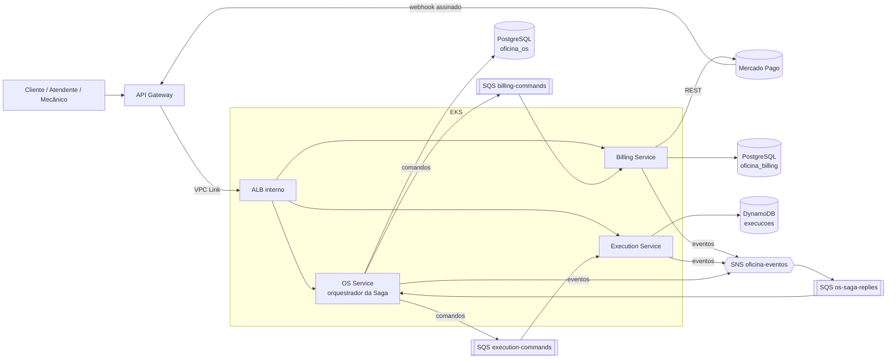
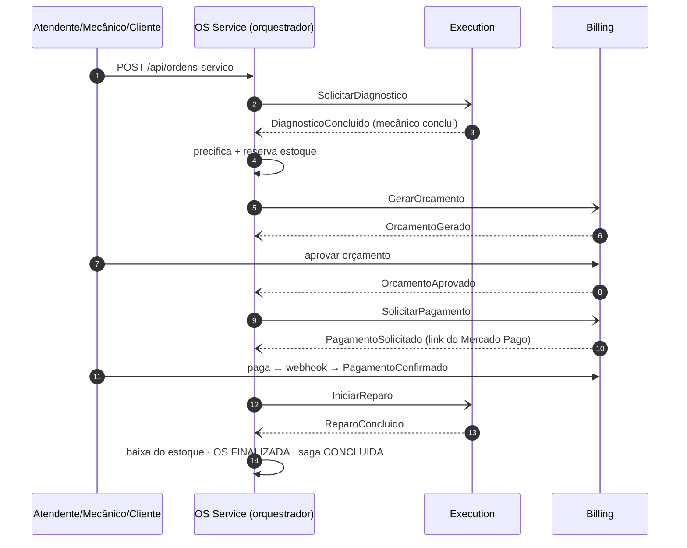

# OS Service — Oficina Mecânica (Tech Challenge SOAT · Fase 4)

[](https://sonarcloud.io/project/overview?id=pedrospinho_soat15-tech-challenge-01)
[](https://sonarcloud.io/project/overview?id=pedrospinho_soat15-tech-challenge-01)

Sistema de gestão para oficinas mecânicas (Pós-Tech SOAT FIAP). Na **Fase 4** o monólito das fases anteriores foi
decomposto em **3 microsserviços independentes** — cada um com repositório, pipeline, infraestrutura e banco próprios —
coordenados por uma **Saga orquestrada** com compensação. **Este repositório é o OS Service**: dono do cadastro
(clientes, veículos, peças, estoque, catálogo), do agregado Ordem de Serviço e do **orquestrador da Saga**.

| Fase | Entrega |
|---|---|
| 1 | API REST completa, DDD em camadas, testes, Swagger |
| 2 | Clean Architecture, Postgres real nos testes, Docker, Kubernetes + HPA |
| 3 | Nuvem: EKS, RDS, Terraform em 4 repos, autenticação por CPF (Lambda + API Gateway), New Relic |
| **4** | **Microsserviços (OS, Billing, Execution), Saga orquestrada, SQS/SNS, DynamoDB, Mercado Pago, SonarCloud** |

Planejamento e decisões: [`PHASE_4_PLAN.md`](docs/PHASE_4_PLAN.md), [`PHASE_4_TASKS.md`](docs/PHASE_4_TASKS.md),
[`RFC-005`](docs/architecture/rfcs/RFC-005-microsservicos-e-saga.md), `ADR-008` a `ADR-015` em
[`docs/architecture/adrs/`](docs/architecture/adrs). Status geral: [`PROJECT_STATUS.md`](docs/PROJECT_STATUS.md).

## Repositórios da solução

| Repositório | Papel | Banco / recursos |
|---|---|---|
| **[`soat15-tech-challenge-01`](https://github.com/PedrosPinho/soat15-tech-challenge-01)** (este) | **OS Service** — cadastros, Ordem de Serviço, orquestrador da Saga | PostgreSQL `oficina_os` · SNS `oficina-eventos` · SQS `os-saga-replies` |
| [`soat15-tech-challenge-billing-service`](https://github.com/PedrosPinho/soat15-tech-challenge-billing-service) | **Billing Service** — orçamento e pagamento (Mercado Pago) | PostgreSQL `oficina_billing` · SQS `billing-commands` |
| [`soat15-tech-challenge-execution-service`](https://github.com/PedrosPinho/soat15-tech-challenge-execution-service) | **Execution Service** — fila de diagnóstico e reparo | **DynamoDB** `execucoes` (NoSQL) · SQS `execution-commands` |
| [`soat15-tech-challenge-db-infra`](https://github.com/PedrosPinho/soat15-tech-challenge-db-infra) | VPC, RDS, security groups, senhas dos roles | Terraform |
| [`soat15-tech-challenge-k8s-infra`](https://github.com/PedrosPinho/soat15-tech-challenge-k8s-infra) | EKS, ALB Controller, New Relic (dashboards/alertas) | Terraform |
| [`soat15-tech-challenge-auth-lambda`](https://github.com/PedrosPinho/soat15-tech-challenge-auth-lambda) | API Gateway, Lambda de token por CPF e Authorizer | Terraform + Lambda |

## Arquitetura da solução



Diagrama detalhado, mensageria e infraestrutura: [`component-diagram.md`](docs/architecture/component-diagram.md).
**Por que 3 serviços** (RFC-005/ADR-008): fronteiras por capacidade de negócio — o cadastro e o ciclo da OS ficam juntos
(são consultados em quase todo passo); cobrança (integração externa, dado financeiro) e execução (fila operacional,
acesso por chave) têm ciclos de vida, escala e falha próprios. Quatro serviços ou um por entidade só trocariam
transações triviais por sagas e chamadas síncronas, sem ganho que cobrisse o custo operacional.
**Bancos**: PostgreSQL onde há dado relacional/transacional (OS, Billing); DynamoDB no Execution, onde o acesso é por
chave e o histórico é uma lista de eventos ([`data-model.md`](docs/architecture/data-model.md)). **Nenhum serviço acessa o banco de outro.**

## Responsabilidades do OS Service

- Cadastro de **clientes** (PF/PJ), **veículos**, **peças**, **estoque** (reserva/baixa atômicas) e **catálogo de serviços**.
- Agregado **Ordem de Serviço** (`RECEBIDA → EM_DIAGNOSTICO → AGUARDANDO_APROVACAO → AGUARDANDO_PAGAMENTO → EM_EXECUCAO → FINALIZADA → ENTREGUE`, `CANCELADA` a partir dos estados não finais) e seu histórico.
- **Orquestrador da Saga** "Ciclo da OS": envia comandos ao Billing e ao Execution, reage às respostas, compensa em caso de falha.
- **Precificação** do orçamento (dono do catálogo e das peças) e **reserva/baixa de estoque**.
- Dashboard (a receita vem do Billing por REST, com timeout e fallback), notificação por e-mail a cada mudança de status.
- `GET /internal/clientes/by-cpf/:cpf` para a Lambda de autenticação (ADR-015).

---

## Saga Pattern — estratégia orquestrada e justificativa

O fluxo *abrir OS → gerar orçamento → aguardar aprovação → pagar → executar* atravessa três
serviços, cada um com seu banco. Não há transação distribuída: usamos uma **Saga orquestrada**,
com o orquestrador **dentro do OS Service** (`src/application/saga/`).

| | Orquestrada (escolhida) | Coreografada |
|---|---|---|
| Fluxo e compensações | num só lugar, declarativos (`ciclo-os.saga.ts`) | espalhados em 3 serviços |
| "Em que passo está a OS X?" | `GET /:id/historico` (estado persistido em `saga_instancias`/`saga_passos_log`) | só reconstruindo eventos |
| Teste | BDD/unitário do orquestrador com bus em memória | exige subir tudo |
| Custo | orquestrador é um ponto crítico (mitigado: estado persistido, lock otimista, sweeper de timeout) | risco de ciclos de eventos |

**Compensação em ordem inversa.** Se o reparo falha: `EstornarPagamento` → `CancelarOrcamento` →
liberar reserva de estoque → `CancelarExecucao` → OS `CANCELADA`. Cada compensação é idempotente
e retentável; se não convergir, a saga vai para `FALHA_COMPENSACAO` (alerta, intervenção manual).

**Confiabilidade.** *Transactional outbox* (estado + mensagem na mesma transação), *inbox*
idempotente por `messageId`, filas SQS com DLQ, lock otimista por `versao` e sweeper de
timeouts (`SAGA_TIMEOUT_APROVACAO`, `SAGA_TIMEOUT_PAGAMENTO`). Contratos das mensagens em
[`docs/architecture/contratos-mensagens.md`](docs/architecture/contratos-mensagens.md);
decisões em `RFC-005` e `ADR-008` a `ADR-015`.

### Fluxo (caminho feliz)



Sequências completas, com o checkout do Mercado Pago, e todas as compensações (reparo falha → estorno →
cancelar orçamento → liberar reserva → cancelar execução):
[`sequence-saga-feliz.md`](docs/architecture/sequence-saga-feliz.md) e
[`sequence-saga-compensacao.md`](docs/architecture/sequence-saga-compensacao.md). Os 6 cenários acima são executáveis
em `tests/bdd/` (ver [Testes](#testes-e-qualidade)).

### Runbook: saga em `FALHA_COMPENSACAO`

A compensação esgotou as tentativas (ex.: estorno recusado pelo Mercado Pago). A OS **não** é cancelada. Alerta no
New Relic ("Saga em FALHA_COMPENSACAO"). Ver `GET /api/ordens-servico/:id/historico` (passo que falhou), corrigir a causa
(ex.: estornar no painel do MP e reconciliar com `POST /internal/pagamentos/:id/sincronizar` no Billing) e tratar a OS
manualmente.

### Variáveis de ambiente da Saga

| Variável | Padrão | Uso |
|---|---|---|
| `MESSAGING_ENABLED` | `true` | `false` sobe só a API (sem Saga) |
| `MESSAGING_DRIVER` | `sqs` | `memory` para dev/testes sem AWS |
| `AWS_ENDPOINT_URL` | — | LocalStack local |
| `EXECUTION_COMMANDS_QUEUE_URL`, `BILLING_COMMANDS_QUEUE_URL`, `SAGA_REPLIES_QUEUE_URL`, `EVENTS_TOPIC_ARN` | — | destinos (saída do Terraform) |
| `SAGA_TIMEOUT_APROVACAO` / `SAGA_TIMEOUT_PAGAMENTO` | `3d` / `1h` | prazo de espera (`30s`, `5m`, `2h`) |
| `SAGA_TIMEOUT_COMPENSACAO` / `SAGA_MAX_TENTATIVAS_COMPENSACAO` | `2m` / `3` | retry de compensação |
| `SAGA_SWEEPER_INTERVAL_MS` / `OUTBOX_RELAY_INTERVAL_MS` | `15000` / `1000` | intervalo dos workers |
| `INTERNAL_API_TOKEN` | — | protege `/internal/*` e a chamada ao Billing |
| `BILLING_SERVICE_URL` | — | `receitaTotal` do dashboard (fallback `null` se fora) |

---

## Stack

| Camada | Tecnologia |
|---|---|
| Runtime / linguagem | Node.js 20 · TypeScript 5 (strict) · Express 5 |
| Banco | PostgreSQL 16 (`pg` + `node-pg-migrate`, sem ORM) |
| Mensageria | Amazon SQS (comandos) + SNS (eventos), *transactional outbox* + *inbox* idempotente + DLQ |
| Notificação | Amazon SES (prod) ou Nodemailer/Mailhog (dev), atrás da mesma port |
| Testes | Jest · ts-jest · Supertest · Testcontainers · `jest-cucumber` (BDD) · LocalStack |
| Qualidade | SonarCloud (quality gate no CI) · ESLint · Prettier |
| Container / orquestração | Docker · Kubernetes (EKS, Ingress em ALB interno compartilhado) |
| IaC | Terraform (`terraform/`: ECR, SNS, SQS) + repos de plataforma |
| CI/CD | GitHub Actions |
| Observabilidade | New Relic (APM, distributed tracing pelas filas, dashboards/alertas por Terraform) |
| Segurança | JWT (interno/cliente), bcrypt, Helmet, rate limiting, `x-internal-token` nas rotas `/internal` |

---

## Arquitetura do serviço

```
src/
├── domain/           # Entidades, value objects, ports (repositórios, IMessageBus, IUnitOfWork, gateways)
├── application/
│   ├── saga/         # orquestrador, definição da Saga (ciclo-os.saga.ts), workers (consumidor, sweeper)
│   ├── messaging/    # outbox relay, tarefas periódicas
│   └── use-cases/    # casos de uso HTTP
├── infrastructure/   # Postgres (repos, UnitOfWork), SQS/SNS e bus em memória, SES/Nodemailer, HTTP (Billing)
├── presentation/     # controllers, rotas (/api e /internal), middlewares, validators
├── main/             # composition root (factories)
└── shared/           # envelope de mensagens, logger, observabilidade (tracing)
```

Ports & Adapters: `IMessageBus` (`SqsSnsMessageBus` | `InMemoryMessageBus`), `IUnitOfWork` (transação por
`AsyncLocalStorage`, sem mudar a assinatura dos repositórios), `IFinanceiroGateway`, `INotificationService`.
Contratos das mensagens: [`contratos-mensagens.md`](docs/architecture/contratos-mensagens.md).

---

## Quick Start

```bash
cp .env.example .env
docker compose up -d                 # app + Postgres + Mailhog + LocalStack (Saga) — API em http://localhost:3001
# ou, sem Docker para a API:
npm install && docker compose up -d postgres mailhog localstack && npm run db:migrate && npm run dev
```

`MESSAGING_ENABLED=false` sobe só a API (sem Saga); `MESSAGING_DRIVER=memory` roda a Saga sem AWS.

**Os 3 serviços juntos (integração local)** — com os repositórios do Billing e do Execution clonados ao lado:

```bash
docker compose -f docker-compose.integration.yml up --build -d
./scripts/smoke-fluxo-feliz.sh        # OS → diagnóstico → orçamento → pagamento (gateway fake) → reparo → FINALIZADA
docker compose -f docker-compose.integration.yml down -v
```

Collection Postman do **fluxo completo** (token → OS → execução → orçamento → pagamento):
[`docs/postman/oficina-fase4-fluxo-completo.postman_collection.json`](docs/postman/oficina-fase4-fluxo-completo.postman_collection.json).

---

## API

### Autenticação

Endpoints marcados como protegidos exigem token JWT no header:

```
Authorization: Bearer <token>
```

Dois tipos de token coexistem (RFC-003, `authMiddleware`):

- **Interno** (`scope: interno`) — e-mail/senha, para uso da equipe da oficina.
- **Cliente** (`scope: cliente`) — CPF, emitido por uma Lambda externa
  ([`auth-lambda`](https://github.com/PedrosPinho/soat15-tech-challenge-auth-lambda)),
  só pode consultar as próprias ordens de serviço (`/buscar`).

**Login interno:**

```bash
POST /api/auth/login
{ "email": "admin@oficina.com", "senha": "senha123" }
```

**Token de cliente por CPF** (via `auth-lambda`, não por esta API diretamente):

```bash
curl -X POST https://8vp6dbqs8g.execute-api.us-east-1.amazonaws.com/auth/token \
  -H "Content-Type: application/json" -d '{"cpf":"52998224725"}'
```

Rodando local/`homolog` sem nenhum cliente/usuário cadastrado ainda? `npm run
db:seed` (depois de `npm run build`) cria o usuário admin acima e um cliente de
teste com o CPF acima — ver [Scripts](#scripts).

### Endpoints

| Método | Rota | Auth | Descrição |
|--------|------|:---:|-----------|
| `GET` | `/health/live` | — | Processo vivo (nunca toca o banco) |
| `GET` | `/health/ready` | — | Postgres alcançável (200/503) — alias em `GET /health` |
| `POST` | `/api/auth/login` | — | Login |
| `POST` | `/api/clientes` | JWT | Criar cliente |
| `GET` | `/api/clientes` | JWT | Listar clientes |
| `GET` | `/api/clientes/:id` | JWT | Buscar cliente |
| `PUT` | `/api/clientes/:id` | JWT | Atualizar cliente |
| `DELETE` | `/api/clientes/:id` | JWT | Desativar cliente |
| `GET` | `/api/clientes/:id/veiculos` | JWT | Listar veículos do cliente |
| `POST` | `/api/veiculos` | JWT | Criar veículo |
| `GET` | `/api/veiculos/:id` | JWT | Buscar veículo |
| `PUT` | `/api/veiculos/:id` | JWT | Atualizar veículo |
| `POST` | `/api/pecas` | JWT | Criar peça |
| `GET` | `/api/pecas` | JWT | Listar peças (filtros: categoria, search) |
| `GET` | `/api/pecas/:id` | JWT | Buscar peça |
| `PUT` | `/api/pecas/:id` | JWT | Atualizar preço/níveis |
| `DELETE` | `/api/pecas/:id` | JWT | Desativar peça |
| `POST` | `/api/servicos` | JWT | Criar serviço no catálogo |
| `GET` | `/api/servicos` | JWT | Listar serviços |
| `GET` | `/api/servicos/:id` | JWT | Buscar serviço |
| `PUT` | `/api/servicos/:id` | JWT | Editar serviço |
| `DELETE` | `/api/servicos/:id` | JWT | Deletar serviço (soft delete) |
| `POST` | `/api/ordens-servico` | JWT | Criar OS (a partir de cpfCnpj + placa; aceita itens do catálogo de serviços) |
| `GET` | `/api/ordens-servico` | JWT | Listar OS (filtros: status, clienteId, veiculoId) — ordenada por status (execução primeiro) e esconde `FINALIZADA`/`ENTREGUE` por padrão |
| `GET` | `/api/ordens-servico/:id` | JWT | Buscar OS por id |
| `GET` | `/api/ordens-servico/buscar?cpfCnpj=` | JWT (cliente ou interno)¹ | Consulta de OS pelo CPF/CNPJ do cliente |
| `PATCH` | `/api/ordens-servico/:id/entregar` | JWT | `FINALIZADA → ENTREGUE` |
| `GET` | `/api/ordens-servico/:id/historico` | JWT | Linha do tempo de status + passos da Saga (e link de pagamento enquanto `AGUARDANDO_PAGAMENTO`) |
| `PATCH` | `/api/ordens-servico/:id/cancelar` | JWT | Dispara a **compensação** da Saga (`202`); a OS vira `CANCELADA` ao final (body: `{ motivo }`) |
| `GET` | `/internal/clientes/by-cpf/:cpf` | `x-internal-token` | Uso da Lambda de auth (fora do API Gateway, fora de `/api`) |
| `GET` | `/api/relatorios/dashboard` | JWT | Dashboard com métricas |

Todo `JWT` na tabela acima é token de **usuário interno** (`scope: interno`, emitido
por `POST /api/auth/login`) exceto onde indicado — rotas de gestão rejeitam token de
cliente com `403`. ¹ `/buscar` aceita os dois escopos: `interno` consulta qualquer
CPF/CNPJ, `cliente` (emitido pela Lambda de CPF em `auth-lambda`) só consulta o
próprio.

As transições `iniciar`/`aguardar-aprovacao`/`aprovar`/`concluir`, o webhook de orçamento e
`/api/pagamentos` **deixaram de existir** no OS Service: o avanço do status é feito pelo
orquestrador da Saga ao receber as respostas do Billing e do Execution. Só `entregar`
(manual) e `cancelar` (dispara compensação) continuam na API.

A cada transição de status da OS, a API dispara — de forma assíncrona, sem bloquear
a resposta HTTP — um e-mail de atualização para o cliente (Mailhog em dev/local).

### Documentação interativa

Com a API rodando, acesse:

- **Swagger UI**: http://localhost:3001/api/docs
- **OpenAPI JSON**: http://localhost:3001/api/docs.json

Para importar no Postman/Insomnia: **Import → Link** apontando para
`http://localhost:3001/api/docs.json`, ou importar a collection versionada em
[`docs/postman/oficina-api.postman_collection.json`](docs/postman/oficina-api.postman_collection.json)
(login preenche `{{token}}` automaticamente via test script).

---

## Fluxo Principal

```
1. POST /api/auth/login                          → obter token JWT
2. POST /api/clientes e /api/veiculos            → cadastrar cliente e veículo
3. POST /api/pecas e /api/servicos               → cadastrar peças e serviços no catálogo
4. POST /api/ordens-servico                      → abrir OS (RECEBIDA) — inicia a Saga
5. PATCH /api/execucoes/:id/diagnostico/concluir → mecânico conclui (Execution Service)
6. (Billing) POST /api/orcamentos/:id/aprovar    → cliente aprova o orçamento
7. (Mercado Pago) cliente paga pelo link         → AGUARDANDO_PAGAMENTO → EM_EXECUCAO
8. PATCH /api/execucoes/:id/reparo/concluir      → FINALIZADA (baixa do estoque)
9. PATCH /api/ordens-servico/:id/entregar        → ENTREGUE
10. GET  /api/ordens-servico/:id/historico       → status + passos da Saga a qualquer momento
11. GET  /api/relatorios/dashboard               → métricas (receita vem do Billing)
```

A cada mudança de status, o cliente recebe um e-mail automático.

---

## Testes e qualidade

```bash
npm test                  # todos (suítes com Testcontainers precisam de Docker)
npm run test:coverage     # com cobertura (threshold global de 80 % no jest.config.js)
npx jest tests/bdd        # os 6 cenários BDD do ciclo da OS
npx jest tests/contracts  # contratos com Billing e Execution
```

**Evidência de cobertura** (mínimo exigido: 80 % por serviço, gate no CI e no SonarCloud):

| Serviço | Linhas | Branches | Como foi medido |
|---|---|---|---|
| Billing | 99,6 % | 92,9 % | `npm run test:coverage`, sem os testes de integração (Postgres/LocalStack) |
| Execution | 99,6 % | 93,2 % | idem (sem LocalStack) |
| OS | _ver o relatório do CI_ | | as suítes com Testcontainers exigem Docker; sem elas: 86,6 % de linhas |

Relatório de cobertura e BDD publicados em cada execução do CI (`GITHUB_STEP_SUMMARY`) e no SonarCloud (badges no topo).

### SonarCloud, BDD e contratos

- **SonarCloud** (substitui o SonarQube local da Fase 3): `sonar-project.properties` aponta para a
  organização/projeto no SonarCloud; o scan roda no CI com o `lcov` do `npm run test:coverage` e o
  `SONAR_TOKEN` (GitHub Secret). Cobertura mínima de 80% por serviço (`coverageThreshold`).
- **BDD do ciclo da OS** (`tests/bdd/features/ciclo-os.feature`, `jest-cucumber`, em português): 6 cenários
  — caminho feliz, orçamento recusado, pagamento recusado, falha no reparo (com estorno), timeout de
  aprovação e mensagem duplicada. O orquestrador real conversa por um `InMemoryMessageBus` com
  participantes simulados de Execution e Billing. `npx jest tests/bdd`.
- **Contratos entre serviços** (`tests/contracts/`): cada serviço produz envelopes reais e os compara com um
  JSON versionado; o JSON do produtor é copiado para o repositório do consumidor, que o alimenta aos
  handlers reais. Regenerar: `UPDATE_CONTRACTS=1 npx jest tests/contracts` (e copiar o JSON para os repos
  que o consomem: `os-commands.json` → Billing/Execution; `billing-events.json` e `execution-events.json` → OS).
- **Integração**: Postgres (Testcontainers) e SQS/SNS reais (`tests/integration/messaging-localstack.spec.ts`,
  exige `LOCALSTACK_ENDPOINT`; o CI sobe o LocalStack como service container).

---

## CI/CD

`build` → `test` (Postgres + LocalStack, cobertura ≥ 80 %, relatório BDD) → `sonar` (SonarCloud, **espera o quality gate**) →
`terraform apply` (ECR, SNS/SQS; em PR roda `terraform plan`) → `docker-build-push` (ECR) → `deploy` (bootstrap de banco,
migration, seed, Deployment/Service/HPA/Ingress, `rollout status`, smoke `/health/ready`). Deploy real só em `homolog`
(em `main` o `apply` vira `plan` e o deploy falha de propósito, ADR-007). Branch protection com `Build`, `Test` e `Sonar`
obrigatórios (`./scripts/protect-branches.sh`). `destroy.yml` manual remove os workloads (Ingress primeiro, para o ALB
não ficar órfão) e a infraestrutura; ordem de destruição no cabeçalho do arquivo.

**Secrets do GitHub**: `AWS_ACCESS_KEY_ID`/`AWS_SECRET_ACCESS_KEY`/`AWS_SESSION_TOKEN` (Learner Lab, sem OIDC; renovados por
[`scripts/refresh-aws-secrets.sh`](scripts/refresh-aws-secrets.sh) nos 6 repositórios), `INTERNAL_API_TOKEN` (o mesmo valor
dos serviços e da Lambda), `SONAR_TOKEN`, `NEW_RELIC_LICENSE_KEY` (opcional — sem ela o agente fica desligado sem erro).
Se a 1ª execução do dia falhar com `ExpiredToken`, rode o script de refresh e reexecute. Nenhum segredo está no repositório:
`JWT_SECRET` e as senhas dos roles vêm do SSM em tempo de deploy.

---

## Kubernetes e Terraform

- `terraform/` — ECR do serviço, tópico SNS `oficina-eventos`, fila `os-saga-replies` (+ DLQ) com assinatura *raw delivery* e
  filter policy por tipo; estado remoto no S3, workspaces `homolog`/`prod`.
- `k8s/` — Deployment/Service (ClusterIP)/HPA, **Ingress** no ALB interno compartilhado pelos 3 serviços (IngressGroup
  `oficina-<env>`), Jobs de bootstrap do banco, migration e seed. Detalhes em [`k8s/README.md`](k8s/README.md).
- Plataforma (VPC, RDS, EKS, API Gateway) nos repositórios da tabela acima. Ordem do 1º deploy: `db-infra` → `k8s-infra` →
  **OS Service** → Execution/Billing → `auth-lambda`.
- `infra/` — cluster **kind** efêmero da Fase 2 (testar manifestos sem AWS).

---

## Observabilidade

Agente APM do New Relic (`newrelic`) carregado como o primeiro `require` de
`src/index.ts`, configurado 100% por env var (`NEW_RELIC_NO_CONFIG_FILE=true`,
sem `newrelic.js`) — `NEW_RELIC_APP_NAME`/`NEW_RELIC_LICENSE_KEY` vêm do
Secret que o pipeline monta por ambiente. Sem a license key (ainda não
configurada — ver abaixo), o agente detecta a licença ausente e fica
desabilitado sem lançar erro, então isso já roda em `homolog` mesmo sem conta
New Relic.

Toda transição de status de uma OS emite um evento customizado
`OrdemServicoStatusChanged` (`numeroOS`, `statusAnterior`, `statusNovo`) —
base do dashboard de tempo médio por status. Infraestrutura do cluster
(CPU/memória de pods/nós, eventos, logs) via `nri-bundle` em
[`soat15-tech-challenge-k8s-infra`](https://github.com/PedrosPinho/soat15-tech-challenge-k8s-infra),
mesmo padrão de "gated até existir a credencial".

### Observabilidade distribuída (Fase 4)

- **Trace único através do SQS/SNS**: quem enfileira captura os headers W3C/New Relic da transação corrente
  (`insertDistributedTraceHeaders`) e os grava no campo opcional `trace` do envelope (e nos `MessageAttributes`
  `traceparent`/`tracestate`/`newrelic`); quem consome abre uma `startBackgroundTransaction` ("Queue") e chama
  `acceptDistributedTraceHeaders`. O trace de uma OS atravessa OS → Billing/Execution → OS. O trace é gravado **no
  momento do enqueue** (não no relay do outbox), senão ele se perderia no caminho transacional. Código em
  `src/shared/observability/tracing.ts` (idêntico nos 3 serviços); sem licença do agente tudo vira no-op.
- **`sagaId`/`ordemServicoId`** entram no contexto do logger (`AsyncLocalStorage`) e como atributos customizados da
  transação — busca "tudo da OS X" em Logs/Distributed Tracing.
- **Eventos customizados** (emitidos *depois do commit*): `SagaIniciada`, `SagaPassoExecutado{passo, acao, resultado}`
  e `SagaFinalizada{resultado, duracaoMs}` (CONCLUIDA | COMPENSADA | FALHA_COMPENSACAO).
- **`FilaProfundidade{servico, fila, tipo, mensagens, emVoo}`** a cada 60 s (`QUEUE_DEPTH_INTERVAL_MS`): cada serviço mede
  as suas filas e DLQs com `GetQueueAttributes`, porque a integração CloudWatch do New Relic é inviável no Learner Lab.
- Dashboard **"Saga / Microsserviços"** e alertas (FALHA_COMPENSACAO, DLQ > 0, taxa de compensação, webhook do MP) em
  `k8s-infra/newrelic_saga.tf`.

**Para ligar de vez**: criar conta New Relic (free tier) e publicar a license
key como GitHub Secret `NEW_RELIC_LICENSE_KEY` neste repositório e em
`k8s-infra`. Detalhes e pendências (instrumentação de Lambda, dashboards) em
[`docs/PHASE_3_TASKS.md`](docs/PHASE_3_TASKS.md) — seção "Etapa 5".

---

## Scripts

```bash
npm run dev             # servidor em modo desenvolvimento (hot reload)
npm run build           # compila TypeScript
npm run start           # inicia versão compilada (produção)
npm run type-check      # verificação de tipos TypeScript
npm run db:migrate      # aplica migrations do Postgres (node-pg-migrate)
npm run db:migrate:down # desfaz a última migration
npm run db:seed         # usuário admin + cliente de teste (precisa de "npm run build" antes — roda a partir de dist/)
npm run docker:up       # sobe todos os serviços Docker
npm run docker:down     # para todos os serviços Docker
npm run docker:logs     # logs dos serviços em tempo real
```

---

## Histórico

Monólito (Fases 1–3): ver [`PHASE_2_PLAN.md`](docs/PHASE_2_PLAN.md), [`PHASE_3_PLAN.md`](docs/PHASE_3_PLAN.md) e
[`component-diagram-fase3.md`](docs/architecture/component-diagram-fase3.md).

---

## Licença

Tech Challenge — Pós-Tech SOAT FIAP
