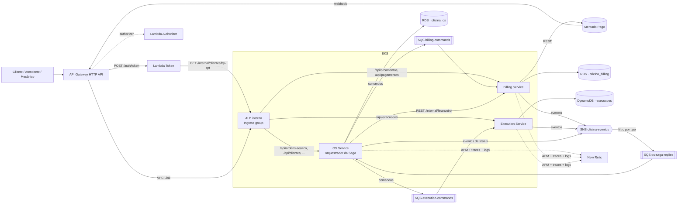
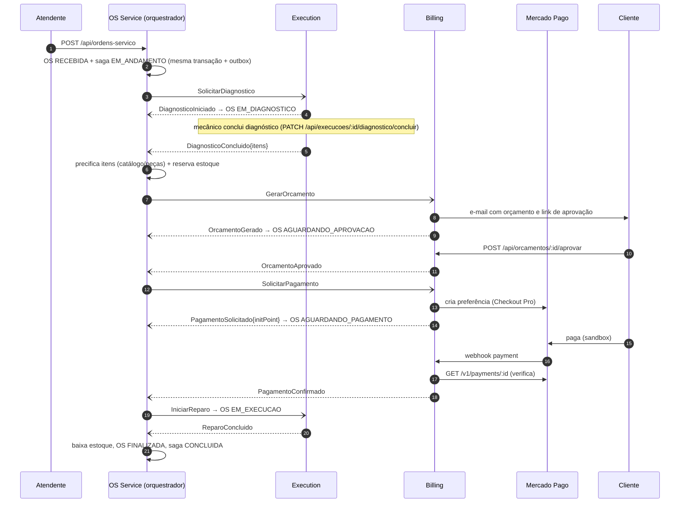
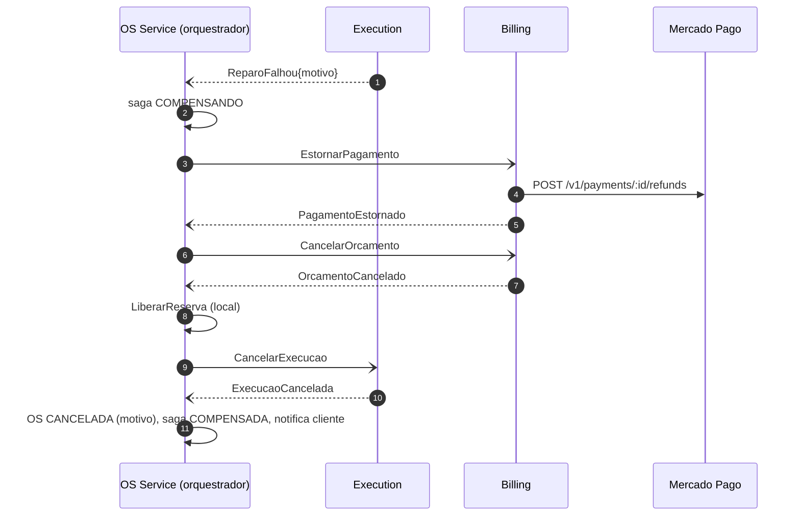

# Planejamento de Desenvolvimento — Fase 4 (Tech Challenge SOAT)

> Fonte: `docs/SOAT - Fase 4 - Tech challenge.pdf`. Checklist executável em
> [`PHASE_4_TASKS.md`](PHASE_4_TASKS.md); passos que dependem de conta externa
> (AWS Learner Lab, GitHub, Mercado Pago, SonarCloud) em
> [`PHASE_4_EXECUTION_GUIDE.md`](PHASE_4_EXECUTION_GUIDE.md).

## Contexto

A Fase 3 terminou com um **monólito modular** (Node.js 20 + TypeScript strict +
Express 5, DDD em camadas) rodando de verdade na AWS (Learner Lab): RDS
PostgreSQL 16, EKS, API Gateway HTTP API + Lambda de autenticação por CPF,
New Relic (APM, `nri-bundle`, 4 dashboards, 6 alertas), 4 repositórios com
CI/CD e branch protection. ~530 testes, cobertura ~97%.

A Fase 4 pede que essa aplicação vire **microsserviços independentes** (mínimo
3, cada um com repositório, infraestrutura e banco próprios), com **Saga
Pattern** e compensação nas transações críticas (abertura de OS → orçamento →
aprovação → pagamento → execução), **mensageria assíncrona**, pelo menos um
banco **SQL** e um **NoSQL**, **integração com o Mercado Pago**, **BDD** em pelo
menos um fluxo completo, **cobertura ≥ 80% por serviço**, **SonarQube (ou
similar) no CI** e **pipeline independente por serviço** com deploy no
Kubernetes.

### Distância entre o que existe e o que a Fase 4 pede

| Requisito da Fase 4 | Estado atual (fim da Fase 3) | Natureza do trabalho |
|---|---|---|
| ≥ 3 microsserviços, repo/infra/banco próprios | 1 aplicação (`soat15-tech-challenge-01`) + 3 repos de infra/auth | **Novo**: 2 serviços novos + refactor do atual |
| Banco próprio por serviço; nenhum acesso cruzado | 1 banco `oficina`; a Lambda de auth lê `clientes` direto no RDS | Isolamento por database/role + Lambda passa a chamar o OS Service por HTTP |
| ≥ 1 SQL **e** ≥ 1 NoSQL | Só PostgreSQL | **Novo**: DynamoDB no Execution Service |
| Mensageria assíncrona | Inexistente (tudo síncrono) | **Novo**: SQS + SNS |
| Saga com rollback/compensação | Transições de status síncronas num só processo | **Novo**: orquestrador no OS Service |
| Mercado Pago | `POST /api/pagamentos` registra pagamento manual já `CONFIRMADO` | **Novo**: Checkout Pro (sandbox) + webhook + estorno |
| BDD em ≥ 1 fluxo completo | Inexistente | **Novo**: `jest-cucumber`, Gherkin em pt-BR |
| Cobertura ≥ 80% por serviço | ✅ só no serviço atual | Manter + replicar nos 2 novos |
| SonarQube/similar **no CI** | SonarQube só local (docker-compose), fora do pipeline | **Novo**: SonarCloud com quality gate como check obrigatório |
| Pipeline independente por serviço → K8s | ✅ só no serviço atual | Replicar nos 2 novos |
| Repos protegidos (PR + checks) | ✅ nos 4 repos atuais | Replicar + incluir o check do Sonar |
| Observabilidade da Fase 3 nos fluxos distribuídos | APM só no monólito | Estender: distributed tracing via mensagens, dashboard de Saga |

---

## Decisões (refinement)

### Confirmadas com o time

| # | Tema | Decisão | Alternativa descartada |
|---|---|---|---|
| D1 | Divisão | **3 serviços**: OS Service (repo atual), Billing Service, Execution Service | Extrair também um Cadastro Service (4 serviços) — mais "puro", muito mais custo de operação |
| D2 | Saga | **Orquestrada**, orquestrador dentro do OS Service com máquina de estados persistida | Coreografada — fluxo e compensações espalhados, difícil de demonstrar/depurar |
| D3 | Mensageria | **Amazon SQS + SNS** (gerenciados, Terraform, sem pod extra) | RabbitMQ no cluster — disputa memória dos nós e morre a cada destroy |
| D4 | NoSQL | **DynamoDB no Execution Service** (fila + histórico de etapas) | MongoDB no cluster; DynamoDB no Billing |
| D5 | Isolamento SQL | **Mesma instância RDS**, um *database* + um *role* por serviço, `REVOKE CONNECT ... FROM PUBLIC` | Uma instância RDS por serviço — dobra custo e tempo de apply |
| D6 | Mercado Pago | **Integração real em sandbox** (credenciais de teste, Checkout Pro, webhook) | Fake atrás de port — não atenderia ao enunciado |
| D7 | Qualidade | **SonarCloud** (repos públicos), quality gate como status check obrigatório | SonarQube subindo no runner a cada execução |
| D8 | Infra por serviço | **`terraform/` dentro de cada repo de serviço** (ECR, filas, tabela, database); `db-infra`/`k8s-infra` seguem como **plataforma compartilhada** (VPC, instância RDS, EKS) | Tudo nos repos de infra — acopla e fere "infraestrutura própria" |
| D9 | Momento do pagamento | **Após a aprovação do orçamento, antes da execução** — permite compensações ricas (estorno no MP se a execução falhar) | Pagamento na entrega — sobra pouca compensação para demonstrar |

### Assumidas no refinement **[DECISÃO]** (ajustáveis)

| # | Tema | Decisão | Por quê |
|---|---|---|---|
| A1 | Nome dos repos novos | `soat15-tech-challenge-billing-service`, `soat15-tech-challenge-execution-service`; o repo atual **mantém o nome** e passa a ser o OS Service | Renomear o atual quebraria links do PDF/README da Fase 3 |
| A2 | Stack dos serviços novos | Mesma do OS Service (Node 20, TS strict, Express 5, DDD em camadas, Jest, pino) | Reaproveita esqueleto, CI e conhecimento; nada no enunciado pede poliglotismo |
| A3 | Código compartilhado | **Copiado** em cada repo (logger, `authMiddleware`, envelope de mensagem, adapter SQS/SNS) — sem pacote npm | Mesma decisão da Fase 3 com o validador de CPF; um pacote exigiria mais um pipeline/registry |
| A4 | Contratos de mensagem | Envelope versionado único + catálogo em `docs/architecture/contratos-mensagens.md` (fonte da verdade, linkado nos 3 READMEs) | Sem repo compartilhado, o contrato precisa de um dono documental |
| A5 | Confiabilidade | **Transactional Outbox** (OS, Billing em Postgres; Execution via `TransactWriteItems` com item de outbox) + **Inbox/idempotência** por `messageId` em todos os consumidores + **DLQ** por fila (`maxReceiveCount=5`) | SQS é *at-least-once*; sem outbox, "gravei no banco mas não publiquei" quebra a saga silenciosamente |
| A6 | Roteamento no cluster | **Um único ALB interno** via `Ingress` com `alb.ingress.kubernetes.io/group.name` (cada repo declara as próprias regras de path) no lugar do NLB por serviço; o VPC Link do API Gateway passa a apontar para o listener do ALB | 1 load balancer em vez de 3; cada serviço continua dono do seu roteamento |
| A7 | Auth Lambda | Deixa de ler `clientes` no RDS; passa a chamar `GET /internal/clientes/by-cpf/:cpf` do OS Service pelo ALB interno, com `x-internal-token` (SSM) | "Nenhum serviço pode acessar diretamente o banco de outro serviço" — a Lambda lendo a tabela do OS Service é exatamente isso |
| A8 | Comunicação síncrona | Só onde há consulta imediata: Lambda → OS (`/internal/clientes`), OS → Billing (`/internal/financeiro/resumo` para o dashboard), Billing → API do Mercado Pago. Rotas `/internal/*` **não** são roteadas pelo API Gateway | Atende "REST síncrono quando necessário" sem acoplar o fluxo transacional |
| A9 | Novo status de OS | `AGUARDANDO_PAGAMENTO` entre `AGUARDANDO_APROVACAO` e `EM_EXECUCAO` | Consequência direta de D9; sem ele o cliente não vê por que a OS parou |
| A10 | Capacidade do cluster | Node group passa de `t3.small` para **`t3.medium`** (2 nós) | `t3.small` aceita só **11 pods/nó** (limite de ENI); kube-system + `nri-bundle` + 3 serviços × 2 réplicas + Jobs não cabem em 22. Plano B: manter `t3.small` com **prefix delegation** do VPC CNI + réplicas mínimas 1 |
| A11 | BDD | `jest-cucumber` (mesmo runner/cobertura do Jest), `# language: pt`, no **OS Service** (o orquestrador vê o fluxo inteiro) | `@cucumber/cucumber` teria cobertura separada e outro runner |
| A12 | Ambiente local/teste | **LocalStack** (SQS, SNS, DynamoDB) no `docker-compose` e nos testes de integração via Testcontainers | Um container cobre os três serviços AWS |
| A13 | Produção | Continua a política do [`ADR-007`](architecture/adrs/ADR-007-producao-nao-implantada-de-verdade.md): deploy real só em `homolog`; `main` roda CI + plan | Orçamento do Learner Lab |
| A14 | Notificações | OS Service notifica mudança de status (como hoje); Billing notifica "orçamento disponível" com link de aprovação/pagamento — cada um com sua cópia da port `INotificationService` (SES/SMTP) | "Geração e **envio** de orçamentos" é responsabilidade do Billing no enunciado |

---

## Arquitetura alvo

### Responsabilidades e dados

| Serviço | Repositório | Responsabilidades | Banco | Tabelas/itens principais |
|---|---|---|---|---|
| **OS Service** (orquestrador) | `soat15-tech-challenge-01` | Abertura de OS, status e histórico, cadastros (clientes, veículos, peças/estoque, catálogo), login interno, **orquestração da Saga**, reserva/baixa de estoque, dashboard | PostgreSQL — database `oficina_os`, role `os_service` | tabelas atuais **menos `pagamentos`**, mais `os_status_historico`, `saga_instancias`, `saga_passos_log`, `outbox`, `mensagens_processadas` |
| **Billing Service** | `soat15-tech-challenge-billing-service` | Orçamento (geração, envio, aprovação/recusa), pagamento via Mercado Pago (preferência, webhook, verificação, estorno), resumo financeiro | PostgreSQL — database `oficina_billing`, role `billing_service` | `orcamentos`, `orcamento_itens`, `pagamentos` (com `mp_preference_id`, `mp_payment_id`, `status_mp`), `outbox`, `mensagens_processadas` |
| **Execution Service** | `soat15-tech-challenge-execution-service` | Fila de execução (diagnóstico e reparo), atualização de etapas pelo mecânico, comunicação de conclusão/falha ao OS Service | **DynamoDB** — tabela `execucoes` (single-table) | `PK=EXEC#<id>, SK=META` (estado atual), `SK=EVT#<ts>` (histórico), GSI1 `status#prioridade`→fila, GSI2 `osId`, itens de outbox/inbox |

Infra compartilhada (inalterada em propósito): `db-infra` (VPC, **instância** RDS),
`k8s-infra` (EKS, LB Controller, `nri-bundle`, dashboards/alertas New Relic),
`auth-lambda` (API Gateway, Lambdas de token/authorizer).

### Diagrama de componentes



### Topologia de mensageria (por ambiente, prefixo `soat15-tc-<env>-`)

| Recurso | Tipo | Produtor → Consumidor | Dono (Terraform) |
|---|---|---|---|
| `billing-commands` (+ DLQ) | SQS | OS → Billing (comandos ponto a ponto) | Billing |
| `execution-commands` (+ DLQ) | SQS | OS → Execution | Execution |
| `oficina-eventos` | SNS | Billing, Execution, OS publicam eventos de domínio | OS |
| `os-saga-replies` (+ DLQ) | SQS inscrita no SNS com *filter policy* por `type` | → OS (respostas da Saga) | OS |

Comandos são **ponto a ponto** (o orquestrador sabe quem executa); respostas são
**eventos publicados no SNS** (o participante não sabe quem é o orquestrador —
outros consumidores podem se inscrever no futuro sem tocar no produtor).

Envelope único de mensagem:

```json
{
  "messageId": "uuid", "type": "GerarOrcamento", "version": 1,
  "sagaId": "uuid", "correlationId": "uuid", "occurredAt": "ISO-8601",
  "payload": { }
}
```

`sagaId` e `correlationId` também vão em `MessageAttributes`, junto com os
headers de distributed tracing do New Relic (ver Etapa 7).

---

## A Saga "Ciclo da OS" (orquestrada)

### Passos e compensações

| # | Passo | Executor | Comando enviado | Sucesso | Falha | Compensação (se um passo posterior falhar) | Status da OS |
|---|---|---|---|---|---|---|---|
| 1 | Abrir OS | OS (local) | — | — | validação | `CancelarOS` (local) | `RECEBIDA` |
| 2 | Diagnóstico | Execution | `SolicitarDiagnostico` | `DiagnosticoConcluido{itens}` | `DiagnosticoFalhou` | `CancelarExecucao` (remove da fila) | `EM_DIAGNOSTICO` (ao receber `DiagnosticoIniciado`) |
| 3 | Reservar peças | OS (local, transação) | — | — | estoque insuficiente | `LiberarReserva` | — |
| 4 | Gerar orçamento | Billing | `GerarOrcamento{itens, valores, cliente}` | `OrcamentoGerado` | `OrcamentoFalhou` | `CancelarOrcamento` | `AGUARDANDO_APROVACAO` |
| 5 | Aprovação do cliente | Billing (cliente via API/webhook) | — | `OrcamentoAprovado` | `OrcamentoRecusado` / **timeout** | — | — |
| 6 | Pagamento | Billing + Mercado Pago | `SolicitarPagamento` | `PagamentoConfirmado` | `PagamentoRecusado` / expirado / timeout | `EstornarPagamento` (refund no MP) | `AGUARDANDO_PAGAMENTO` |
| 7 | Reparo | Execution | `IniciarReparo` | `ReparoConcluido` | `ReparoFalhou` | — (último passo compensável) | `EM_EXECUCAO` → `FINALIZADA` |
| 8 | Finalizar | OS (local) | — | baixa definitiva do estoque reservado | — | **ponto sem volta** (pivot) | `FINALIZADA` |

`ENTREGUE` continua manual (`PATCH /:id/entregar`), fora da Saga.

Compensação é executada **em ordem inversa** a partir do último passo concluído.
Exemplo — reparo falha (passo 7): `EstornarPagamento` → `CancelarOrcamento` →
`LiberarReserva` → `CancelarExecucao` → `CancelarOS(motivo)` → notificação ao
cliente. Cada compensação é idempotente e retentável; se uma compensação
esgotar as tentativas, a saga vai para `FALHA_COMPENSACAO` e dispara alerta
(intervenção manual, documentada no runbook do README).

### Diagrama de sequência — caminho feliz



### Diagrama de sequência — falha no reparo com compensação



### Persistência da Saga (OS Service)

- `saga_instancias(id, ordem_servico_id UNIQUE, passo_atual, status, dados jsonb, versao, expira_em, criado_em, atualizado_em)` —
  `status ∈ {EM_ANDAMENTO, COMPENSANDO, CONCLUIDA, COMPENSADA, FALHA_COMPENSACAO}`;
  **lock otimista** por `versao` (duas respostas concorrentes da mesma saga não
  avançam o passo duas vezes).
- `saga_passos_log(saga_id, passo, acao, resultado, mensagem_id, ocorrido_em)` —
  trilha de auditoria; alimenta `GET /api/ordens-servico/:id/historico` e o
  dashboard de Saga.
- **Timeouts**: um *sweeper* (intervalo configurável) varre `expira_em` vencido
  nos passos de espera (5 e 6) e dispara a compensação. Para o vídeo, timeouts
  curtos por env var (`SAGA_TIMEOUT_APROVACAO=5m`, `SAGA_TIMEOUT_PAGAMENTO=5m`).
- Mudanças no agregado `OrdemServico`: novo status `AGUARDANDO_PAGAMENTO`,
  `estornarPagamento()` (zera `temPagamento`, destrava `cancelar()`),
  transições passam a ser chamadas **pelo orquestrador**; os endpoints manuais
  `iniciar`/`aguardar-aprovacao`/`aprovar`/`concluir` saem da API pública
  (ficariam furando a Saga). `cancelar` manual continua, mas agora **dispara a
  compensação** em vez de só trocar o status.

### Injeção de falhas (para testes e para o vídeo)

- Pagamento recusado: cartão de teste do Mercado Pago com titular `OTHE`
  (aprovado: `APRO`) — falha real, sem código especial.
- Reparo falha: `PATCH /api/execucoes/:id/reparo/falhar` (`{ "motivo": "peça indisponível" }`) — caso de uso legítimo do mecânico, não um "botão de teste".
- Orçamento recusado: `POST /api/orcamentos/:id/recusar`.
- Timeout: deixar o orçamento sem resposta com `SAGA_TIMEOUT_APROVACAO` curto.
- Falha de infraestrutura: escalar o Billing para 0 réplicas → mensagens ficam
  na fila (sem perda) → voltar para 1 → saga continua (demonstra a resiliência
  da mensageria).

---

## Visão geral das entregas (mapeadas ao enunciado)

| # | Etapa | Requisito do enunciado |
|---|---|---|
| 0 | Fundação: validação do Learner Lab (SQS/SNS/DynamoDB/`t3.medium`), repos novos, contas Mercado Pago e SonarCloud | Infraestrutura / Repos |
| 1 | Contratos, ADRs/RFC e esqueleto dos serviços novos | Documentação / Separação |
| 2 | OS Service: extração de pagamentos, isolamento de banco, orquestrador, outbox/inbox, endpoints internos | Separação + Saga + Comunicação |
| 3 | Execution Service (DynamoDB) | Separação + NoSQL |
| 4 | Billing Service (Postgres + Mercado Pago) | Separação + Pagamentos |
| 5 | Plataforma: `k8s-infra` (nós, ALB/Ingress), `db-infra` (bootstrap de databases/roles), `auth-lambda` (rotas + Lambda via HTTP) | Infraestrutura |
| 6 | Testes: unitários, integração (LocalStack/Testcontainers), **BDD do fluxo completo**, cobertura ≥ 80% por serviço | Testes e Qualidade |
| 7 | Observabilidade distribuída (tracing via mensagens, dashboard/alertas de Saga) | Infraestrutura (monitoramento da Fase 3) |
| 8 | CI/CD por serviço + SonarCloud + branch protection | CI/CD |
| 9 | Documentação, Swagger/Postman, vídeo, PDF | Entregáveis |

---

## Etapa 0 — Fundação

- Validar no Learner Lab (antes de qualquer Terraform novo): criação de **SQS**,
  **SNS** (com assinatura SQS + filter policy), **DynamoDB** (on-demand), e
  node group **`t3.medium`**; e que um pod alcança SQS/DynamoDB com a `LabRole`
  via IMDS (mesmo mecanismo do LB Controller na Fase 3, hop limit 2 já
  configurado). Planos B: SQS indisponível → RabbitMQ no cluster atrás da mesma
  port `IMessageBus`; DynamoDB indisponível → MongoDB StatefulSet; `t3.medium`
  bloqueado → `t3.small` + prefix delegation.
- Criar `soat15-tech-challenge-billing-service` e `soat15-tech-challenge-execution-service` (públicos, `main` + `homolog`, `soat-architecture` como colaborador).
- Conta de desenvolvedor **Mercado Pago**: aplicação de teste, *access token* de
  teste, *webhook secret*, usuários de teste comprador/vendedor.
- **SonarCloud**: organização ligada ao GitHub, 3 projetos (um por serviço), `SONAR_TOKEN` por repo.
- Estender `scripts/refresh-aws-secrets.sh` para publicar nos **6** repositórios.

## Etapa 1 — Contratos, documentação de decisão e esqueletos

- `docs/architecture/contratos-mensagens.md`: envelope, catálogo de comandos/eventos (nome, versão, produtor, consumidor, payload, exemplo JSON).
- `RFC-005` decomposição em microsserviços e estratégia de Saga (alternativas avaliadas).
- ADRs: `ADR-008` divisão em 3 serviços (D1); `ADR-009` Saga orquestrada (D2);
  `ADR-010` SQS + SNS, outbox/inbox e DLQ (D3, A5); `ADR-011` DynamoDB no
  Execution (D4); `ADR-012` isolamento por database/role na mesma instância (D5);
  `ADR-013` ALB interno com IngressGroup (A6); `ADR-014` Mercado Pago Checkout
  Pro com pagamento após aprovação (D6, D9); `ADR-015` Lambda de auth via HTTP
  em vez de acesso ao banco (A7).
- Esqueleto dos 2 repos novos copiando do OS Service: estrutura DDD, `tsconfig`,
  Jest (thresholds 80%), pino + correlationId, `authMiddleware`, healthchecks
  `/health/live`/`ready`, Dockerfile, `docker-compose` (app + LocalStack [+ postgres no Billing]), Swagger, `k8s/`.

## Etapa 2 — OS Service (refactor do repo atual)

- **Extração de pagamentos**: remove `Pagamento` (entidade, repo, use cases,
  rotas `/api/pagamentos`) e a tabela `pagamentos` (migration de drop — o banco
  é recriado a cada sessão, não há dado a migrar). `DashboardUseCase` passa a
  obter `receitaTotal` do Billing via `GET /internal/financeiro/resumo` (com
  timeout e *fallback* `null` se o Billing estiver fora — o dashboard não pode
  cair junto).
- **Isolamento de banco**: app passa a conectar como `os_service` no database
  `oficina_os` (hoje usa o usuário master `oficina` no database `oficina`).
- **Port `IMessageBus`** (publish/send/subscribe) + adapters `SqsSnsMessageBus` (AWS SDK v3) e `InMemoryMessageBus` (testes/BDD).
- **Outbox**: tabela `outbox` gravada na mesma transação da mudança de estado;
  *relay* em background (poll com `FOR UPDATE SKIP LOCKED`, seguro com 2+
  réplicas) publica e marca como enviada.
- **Inbox**: consumidor de `os-saga-replies` com long polling, deduplicação por
  `messageId` em `mensagens_processadas` na mesma transação do handler.
- **Orquestrador** (`src/application/saga/`): definição declarativa dos passos
  (tabela da seção anterior), handlers por evento, compensação em ordem inversa,
  lock otimista, sweeper de timeout.
- **Estoque religado**: o `InventoryService` (hoje órfão, achado da Fase 3) passa
  a ser usado pelos passos 3 (reserva), 8 (baixa) e pela compensação (liberação),
  com as operações atômicas que o `PostgresItemEstoqueRepository` já tem.
- **Histórico**: `os_status_historico` + `GET /api/ordens-servico/:id/historico`
  (status + passos da Saga) — atende "consulta de status e histórico".
- **Endpoints internos** (fora do API Gateway, com `x-internal-token`):
  `GET /internal/clientes/by-cpf/:cpf` (para a Lambda).
- Remover da API pública `iniciar`/`aguardar-aprovacao`/`aprovar`/`concluir` e o
  webhook de orçamento (migra para o Billing); `cancelar` passa a acionar a
  compensação.
- `terraform/` próprio: ECR `soat15-tc-os-service`, tópico SNS `oficina-eventos`,
  fila `os-saga-replies` + DLQ + assinatura com filter policy.

## Etapa 3 — Execution Service (DynamoDB)

- Agregado `Execucao` (`AGUARDANDO_DIAGNOSTICO → EM_DIAGNOSTICO → DIAGNOSTICADA → AGUARDANDO_REPARO → EM_REPARO → CONCLUIDA | FALHOU | CANCELADA`), com prioridade e ordem de chegada.
- Consumidor de `execution-commands`: `SolicitarDiagnostico`, `IniciarReparo`, `CancelarExecucao` (idempotentes via `ConditionExpression`).
- API (escopo `interno`): `GET /api/execucoes/fila`, `GET /api/execucoes/:id`,
  `PATCH /:id/diagnostico/iniciar`, `PATCH /:id/diagnostico/concluir` (itens:
  `catalogoServicoId` + peças/quantidades — a **precificação fica no OS Service**,
  dono do catálogo), `PATCH /:id/reparo/iniciar`, `PATCH /:id/reparo/concluir`,
  `PATCH /:id/reparo/falhar`.
- Eventos: `DiagnosticoIniciado`, `DiagnosticoConcluido`, `DiagnosticoFalhou`,
  `ReparoIniciado`, `ReparoConcluido`, `ReparoFalhou`, `ExecucaoCancelada`.
- Outbox: item de outbox gravado na mesma `TransactWriteItems` da mudança de
  estado + relay. Inbox: `PutItem` condicional em `INBOX#<messageId>` com TTL.
- `terraform/`: ECR, tabela `execucoes` (on-demand, GSIs, TTL), fila `execution-commands` + DLQ (com policy permitindo envio do OS).
- `k8s/`: Deployment, Service, HPA, ConfigMap, Ingress (group `oficina-<env>`, path `/api/execucoes`).

## Etapa 4 — Billing Service (PostgreSQL + Mercado Pago)

- Agregados `Orcamento` (`GERADO → APROVADO | RECUSADO | CANCELADO | EXPIRADO`) e
  `Pagamento` (`PENDENTE → CONFIRMADO | RECUSADO | ESTORNADO`), ligados por `ordemServicoId`.
- Consumidor de `billing-commands`: `GerarOrcamento`, `CancelarOrcamento`,
  `SolicitarPagamento`, `EstornarPagamento`.
- Port `IPaymentGateway` + adapter `MercadoPagoPaymentGateway` (SDK oficial
  `mercadopago` ou REST): criar preferência (Checkout Pro, `external_reference = orcamentoId`,
  `notification_url` = rota pública do API Gateway), consultar pagamento,
  estornar. Fake para testes unitários/BDD; integração real em sandbox validada à parte.
- API: `GET /api/orcamentos/:id` (cliente dono ou interno; inclui `initPoint`),
  `POST /api/orcamentos/:id/aprovar|recusar` (escopo `cliente` só no próprio
  orçamento), `POST /api/orcamentos/:id/webhook` (aprovação externa por segredo
  compartilhado, herdado do monólito), `GET /api/pagamentos?ordemServicoId=`,
  `POST /api/pagamentos/webhooks/mercadopago` (**público**, validação de
  `x-signature` HMAC com o secret do MP; o payload nunca é confiado — sempre
  `GET /v1/payments/:id` antes de confirmar), `GET /internal/financeiro/resumo`.
- Notificação "orçamento disponível" (e-mail com valores e link).
- `terraform/`: ECR, fila `billing-commands` + DLQ, parâmetros SSM
  (`/soat15-tc/<env>/billing/mp-access-token`, `mp-webhook-secret`). Nenhuma
  assinatura SNS: o Billing só **publica** no tópico `oficina-eventos` (dono: OS).
- `k8s/`: idem Execution, Ingress em `/api/orcamentos` e `/api/pagamentos`, Job de migration.

## Etapa 5 — Plataforma compartilhada

- **`db-infra`**: Job/script de bootstrap idempotente (executado pelo pipeline de
  cada serviço com a senha master do SSM) que cria `oficina_os`/`oficina_billing`,
  os roles `os_service`/`billing_service` com senha gerada no SSM, e `REVOKE CONNECT ON DATABASE ... FROM PUBLIC`.
  [DECISÃO] Job do Kubernetes em vez do provider `postgresql` do Terraform —
  o runner do GitHub não alcança o RDS em subnet privada.
- **`k8s-infra`**: `node_instance_type = t3.medium` (A10); tópico/filas **não**
  entram aqui (são dos serviços). Conferir capacidade do `nri-bundle` (reduzir componentes não usados).
- **`auth-lambda`**: integração do VPC Link trocada de NLB para o **listener do
  ALB** (A6); rota pública nova `POST /api/pagamentos/webhooks/mercadopago`
  (sem authorizer); demais `/api/*` continuam com authorizer (o roteamento por
  serviço é feito pelo Ingress, não pelo API Gateway); Lambda de token passa a
  chamar `/internal/clientes/by-cpf/:cpf` (A7) — remove `pg`, `db.ts` e a
  regra do SG da Lambda → RDS.

## Etapa 6 — Testes e qualidade

- **Unitários** em todos os serviços (domínio, use cases, handlers de mensagem, orquestrador com `InMemoryMessageBus`).
- **Integração**: Postgres via Testcontainers (já existe), SQS/SNS/DynamoDB via LocalStack (Testcontainers `GenericContainer`).
- **BDD** (`jest-cucumber`, no OS Service) — `tests/bdd/features/ciclo-os.feature`:
  1. Caminho feliz: OS aberta → diagnóstico → orçamento → aprovado → pago → reparo → `FINALIZADA`.
  2. Orçamento recusado → reserva liberada, execução cancelada, OS `CANCELADA`.
  3. Pagamento recusado → orçamento cancelado, reserva liberada, OS `CANCELADA`.
  4. Reparo falha → **estorno**, orçamento cancelado, reserva liberada, OS `CANCELADA`.
  5. Timeout de aprovação → compensação.
  6. Mensagem duplicada não avança a saga duas vezes (idempotência).
  Os participantes são simulados por *fakes* que respondem pelo `InMemoryMessageBus`; o OS Service roda com Postgres real (Testcontainers).
- **Cobertura ≥ 80%** em cada serviço (`coverageThreshold` no `jest.config.js` — o CI falha abaixo disso) + badge do SonarCloud no README.
- **SonarCloud**: `sonar-project.properties` por repo, scan no CI com `lcov`, quality gate obrigatório para merge.
- Corrigir de passagem o `npm run lint` quebrado desde a Fase 2 (`eslint@10` exige `eslint.config.js`) — o quality gate não deve conviver com lint desligado.

## Etapa 7 — Observabilidade distribuída

- Agente New Relic nos 2 serviços novos (mesmo padrão do OS Service: `NEW_RELIC_LICENSE_KEY` no Secret, `NEW_RELIC_APP_NAME=<serviço>-<env>`).
- **Distributed tracing através do SQS/SNS**: o produtor insere os headers de
  trace (`newrelic.getTransaction().insertDistributedTraceHeaders`) nos
  `MessageAttributes`; o consumidor abre `startBackgroundTransaction` e chama
  `acceptDistributedTraceHeaders('Queue', headers)` — o trace da OS atravessa os 3 serviços no *Distributed Tracing* do New Relic.
- `sagaId` e `ordemServicoId` como atributos em todo log e transação (busca de "tudo da OS X" no Logs).
- Eventos customizados `SagaPassoExecutado` / `SagaFinalizada{resultado, duracaoMs}`.
- **Profundidade de fila/DLQ**: a integração CloudWatch do New Relic é
  inviável no Learner Lab (achado da Fase 3: exige IAM role própria), então
  cada serviço publica periodicamente `ApproximateNumberOfMessages` das suas
  filas/DLQs como evento customizado `FilaProfundidade`.
- Dashboard novo **"Saga / Microsserviços"** (em `k8s-infra/newrelic_dashboards.tf`): sagas iniciadas/concluídas/compensadas por hora, duração por passo, taxa de compensação, profundidade de filas e DLQs, throughput/erros por serviço, service map.
- Alertas novos: saga em `FALHA_COMPENSACAO` > 0; mensagem em DLQ > 0; taxa de compensação acima do limiar; webhook do Mercado Pago com erro.

## Etapa 8 — CI/CD

Pipeline independente por serviço (mesmo desenho do `ci-cd.yml` atual):

`build` (type-check, lint, build) → `test` (cobertura ≥ 80%, LocalStack/Postgres) → `sonar` (SonarCloud + quality gate) → `terraform` (plan em PR, apply em push — ECR/filas/tabela) → `docker-build-push` (ECR do serviço) → `deploy` (bootstrap de banco quando aplicável, Job de migration, Deployment/Service/HPA/Ingress, `rollout status`, smoke `/health/ready`).

- Branch protection em `main`/`homolog` nos 6 repos, com **`build`, `test` e `sonar` como status checks obrigatórios** nos 3 serviços.
- Deploy real apenas em `homolog` (A13).
- Ordem de deploy na primeira subida: plataforma (`db-infra` → `k8s-infra`) → OS Service (dono do SNS e da fila de respostas) → Execution e Billing (em qualquer ordem) → `auth-lambda` (fase 2, aponta para o ALB).

## Etapa 9 — Documentação e entregáveis

- **README de cada serviço**: propósito, responsabilidades, arquitetura do serviço (diagrama), banco e por quê, contratos que produz/consome, endpoints, como rodar local, CI/CD, **evidência de cobertura** (badge SonarCloud + print do relatório), link do Swagger/Postman.
- README do OS Service: seção **"Saga Pattern — por que orquestrada"** (exigência explícita do PDF) + diagramas de sequência.
- `docs/architecture/`: `component-diagram.md` atualizado para microsserviços, `sequence-saga-*.md`, `data-model.md` dividido por serviço (ER do `oficina_os`, ER do `oficina_billing`, modelo single-table do DynamoDB).
- Swagger por serviço + collection Postman atualizada cobrindo o fluxo completo (com variáveis encadeadas).
- **Vídeo (≤ 15 min)** — roteiro em [`PHASE_4_EXECUTION_GUIDE.md`](PHASE_4_EXECUTION_GUIDE.md): fluxo completo, Saga com falhas e compensação, deploy automatizado com testes, monitoramento/rastreamento distribuído.
- **PDF**: participantes, links dos repos, link do vídeo, diagrama geral (serviços, bancos, comunicação), estratégia de Saga, justificativa da divisão e das tecnologias.

---

## Ordem de execução recomendada

1. **Etapa 0** — validações e contas primeiro: SQS/SNS/DynamoDB/`t3.medium` no lab, Mercado Pago e SonarCloud levam tempo de cadastro.
2. **Etapa 1** — contratos de mensagem **antes** de qualquer código de serviço: são a interface entre três repositórios.
3. **Etapa 2** (OS Service) — maior risco (refactor + orquestrador); começar pelo `IMessageBus` + `InMemoryMessageBus` + orquestrador testado em memória, BDD junto (Etapa 6).
4. **Etapas 3 e 4** em paralelo — Execution é mais simples (bom para validar o padrão de consumidor/outbox no DynamoDB); Billing depende do sandbox do MP.
5. **Etapa 5** — plataforma, só quando houver imagem dos 3 serviços para implantar.
6. **Etapa 8** — pipelines, primeiro em `homolog`.
7. **Etapa 7** — observabilidade depois do fluxo estável na nuvem.
8. **Etapa 9** — documentação final, ensaio e gravação do vídeo numa sessão recém-aplicada.

---

## Riscos e pontos de atenção

| Risco | Impacto | Mitigação |
|---|---|---|
| Cluster sem capacidade de pods (`t3.small` = 11 pods/nó) | Pods `Pending`, deploy falha | `t3.medium` (A10); réplicas mínimas 1 em homolog; prefix delegation como plano B |
| Mensagem perdida entre gravar e publicar | Saga travada sem erro visível | Outbox transacional + relay; sweeper de timeout como rede de segurança |
| Mensagem duplicada (SQS at-least-once) | Passo executado 2x (ex.: 2 estornos) | Inbox por `messageId` + lock otimista na saga + operações idempotentes no MP (`X-Idempotency-Key`) |
| Webhook do MP não chega (sandbox instável, URL errada) | Saga parada em `AGUARDANDO_PAGAMENTO` | Endpoint de reconciliação `POST /internal/pagamentos/:id/sincronizar` (consulta o MP) + timeout de pagamento |
| Webhook forjado | Pagamento falso confirmado | Validação `x-signature` + **sempre** consultar `GET /v1/payments/:id` |
| Learner Lab bloquear SQS/SNS/DynamoDB | Retrabalho de etapa inteira | Validação no dia 1; planos B atrás das mesmas ports (`IMessageBus`, repositório do Execution) |
| Sessão do lab expira no meio do apply de 6 repos | Estado travado, pipelines vermelhas | Script de refresh nos 6 repos; aplicar no início da sessão; `force-unlock` documentado |
| Cobertura < 80% nos serviços novos | Requisito descumprido | Threshold no Jest desde o primeiro commit (o CI falha cedo, não no fim) |
| Escopo grande para o prazo | Entrega incompleta | Caminho crítico = Saga + 3 serviços + BDD + CI; Swagger fino, `SNS` extra e alertas novos são cortáveis por último |
| Orçamento do lab (3 serviços + ALB + `t3.medium`) | Crédito esgotado antes do vídeo | Destroy por sessão (workflows `destroy.yml` já existem), estimar custo/hora na Etapa 0 |

---

## Verificação

- `npm run type-check`, `npm run lint` e `npm run test:coverage` verdes nos 3 serviços, cada um ≥ 80%.
- BDD: os 6 cenários de `ciclo-os.feature` verdes no CI do OS Service.
- `docker compose up` em cada serviço sobe app + dependências (LocalStack/Postgres); um `docker-compose` de integração local (no OS Service) sobe os 3 serviços juntos e o fluxo feliz roda ponta a ponta.
- SonarCloud com quality gate verde nos 3 projetos; PR sem o check do Sonar não pode ser mergeado.
- Na AWS (`homolog`): fluxo completo via API Gateway (atendente abre OS → mecânico diagnostica → cliente aprova → paga no sandbox do MP → mecânico conclui → `FINALIZADA`); cartão `OTHE` leva a `CANCELADA` com orçamento cancelado e reserva liberada; `reparo/falhar` gera estorno visível no painel do MP.
- Nenhum acesso cruzado: `psql` como `billing_service` no `oficina_os` é **negado**; a Lambda de auth não tem mais rota/SG para o RDS.
- New Relic: um único trace distribuído mostra OS → SQS → Billing → SNS → OS; dashboard de Saga populado; mensagem forçada na DLQ dispara alerta.
- Os 6 repos com `main`/`homolog` protegidas e os checks obrigatórios configurados; `soat-architecture` colaborador nos 2 repos novos.
