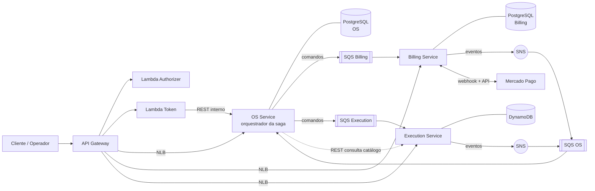

# Planejamento de Desenvolvimento — Fase 4 (Tech Challenge SOAT)

## Contexto

A Fase 3 entregou a operação em nuvem do monólito: aplicação Node.js 20 + TypeScript (Express 5, DDD em camadas, PostgreSQL) rodando num EKS, atrás de um API Gateway com autenticação por CPF via Lambda, banco RDS gerenciado, observabilidade no New Relic e quatro repositórios com CI/CD em `homolog` (ver `docs/PROJECT_STATUS.md` e `docs/architecture/`). Tudo isso roda no AWS Academy Learner Lab, com as restrições registradas em `ADR-006` (sem IAM próprio, sem IRSA, `LabRole` compartilhada) e `ADR-007` (produção não implantada de verdade).

A Fase 4 muda a **forma** do sistema, não o ambiente. O enunciado (`SOAT - Fase 4 - Tech challenge.pdf`, vale 90% da nota) exige:

- **No mínimo 3 microsserviços**, cada um com repositório, infraestrutura e banco próprios; ao todo, pelo menos um banco **SQL** e pelo menos um **NoSQL**.
- Comunicação **REST síncrona** (quando necessário) e **mensageria assíncrona**; **nenhum serviço acessa o banco de outro**.
- **Saga Pattern** (orquestrada ou coreografada) para o fluxo da OS, com **compensação/rollback**; a escolha precisa ser justificada no README.
- Pagamento integrado ao **Mercado Pago**.
- Testes unitários em todos os serviços, **um fluxo completo em BDD**, **cobertura ≥ 80% por serviço** e **SonarQube (ou similar) no CI**.
- CI/CD independente por serviço (build, testes, qualidade, deploy em Kubernetes) e `main` protegida.
- Observabilidade da Fase 3 reaproveitada, agora cobrindo fluxos distribuídos.
- Entregáveis: repositórios, **vídeo de até 15 min** (fluxo da OS entre serviços, saga com falha, deploy automatizado, rastreamento distribuído) e **PDF** com participantes, links, diagrama final, estratégia de saga e justificativa da divisão.

Este documento é o **plano de desenvolvimento** (backlog priorizado, não o código). Pontos de decisão estão marcados como **[DECISÃO]** para confirmação antes da implementação.

**Distância entre o que existe e o que a Fase 4 pede:**

| Requisito da Fase 4 | Estado atual (fim da Fase 3) | Natureza do trabalho |
|---|---|---|
| ≥ 3 microsserviços, repo/infra/banco próprios | 1 monólito + 3 repositórios de infra | **Extração** (maior esforço da fase) |
| SQL + NoSQL | Só PostgreSQL (o MongoDB foi removido na Fase 3) | Novo banco NoSQL |
| Mensageria | Inexistente | Novo |
| Saga com compensação | Inexistente; transições de OS são chamadas diretas | Novo |
| Mercado Pago | `Pagamento` é registro manual, confirmado na hora | Novo |
| Nenhum serviço acessa o banco de outro | `auth-lambda` consulta `clientes` direto no RDS | Corrigir |
| BDD | Só Jest | Novo |
| Sonar no CI | `sonar-project.properties` só para uso local | Novo no pipeline |
| Rastreamento distribuído | Correlation-id HTTP + APM por processo | Estender às mensagens |

---

## Achados na leitura do código que moldam o plano

Lidos em `origin/main` (monólito) e nos clones de `auth-lambda`, `db-infra` e `k8s-infra`. Nenhum está no enunciado; todos mudam o escopo.

1. **A OS nunca reserva estoque.** `InventoryService` só é referenciado por seus próprios testes, não existe rota de estoque, e o único consumidor de `IItemEstoqueRepository` é o dashboard. "Reservar peças" como etapa compensável da saga é **funcionalidade nova**, não migração.
2. **`CreatePagamentoUseCase` faz duas escritas sem transação** (`osRepo.update` e depois `pagamentoRepo.save`). Se a segunda falhar, a OS fica com `temPagamento = true` sem pagamento. É o exemplo real de inconsistência que a saga resolve, e vale mostrá-lo no README.
3. **`OrdemServico.cancelar` proíbe cancelar com pagamento**, e `Pagamento.cancelar` proíbe cancelar um pagamento confirmado. Compensar um pagamento exige um estado novo (`ESTORNADO`) e que o estorno limpe `temPagamento` **antes** do cancelamento da OS, preservando a invariante existente.
4. **`entregar()` não exige pagamento.** Hoje uma OS pode ser entregue sem ter sido paga. Com cobrança real, vira invariante nova.
5. **Não existe histórico de status.** O enunciado pede "consulta de status e histórico" no OS Service; hoje só há status atual e duas datas. A tabela de histórico também alimenta a métrica "tempo médio por status" que a Fase 3 já exigia.
6. **`CreateOrdemServicoUseCase` lê cliente, veículo, catálogo e peças.** Cliente e veículo ficam no OS Service; catálogo e peças não (ver divisão abaixo), então a abertura da OS passa a depender de uma consulta ao Execution.
7. **`DashboardUseCase` junta OS, pagamentos e estoque** numa só chamada: consulta cruzada entre três serviços.
8. **`auth-lambda` consulta `clientes` diretamente** (`src/shared/db.ts`, `findClienteByCpf`), com a senha do RDS injetada como variável de ambiente. Dentro da regra "nenhum serviço acessa o banco de outro", isso é uma violação.
9. **O API Gateway tem uma rota só para a aplicação** (`ANY /api/{proxy+}` → um VPC Link → um NLB localizado por tag `service.k8s.aws/stack`), e o apply já é em duas fases por causa da dependência circular com o NLB. Com 3 serviços essa dependência triplica.
10. **Estoque em NoSQL perde a busca textual.** `GET /api/pecas?search=` usa índice GIN do Postgres; DynamoDB não tem equivalente.
11. **Os nós são `t3.small`** (min 2 / max 4). Pelo meu cálculo, esse tipo comporta ~11 pods por nó com o `vpc-cni` padrão, e o cluster já carrega `aws-node`, `kube-proxy`, `coredns`, `metrics-server`, LB controller e o `nri-bundle`. **Verificar com `kubectl describe node`** antes de assumir folga para 3 serviços.
12. O `sonar-project.properties` do monólito tem `sonar.login=admin` / `sonar.password=admin` (uso local). O CI precisa de configuração própria, com token em Secret.

---

## [DECISÃO] Padrões assumidos (ajustáveis a qualquer momento)

**Divisão em microsserviços (por bounded context)**

| Serviço | Responsabilidade | Agregados que possui | Banco |
|---|---|---|---|
| **OS Service** (repo atual `soat15-tech-challenge-01`) | Abertura, status, histórico e consulta de OS; clientes, veículos e usuários internos; **orquestrador da saga** | `OrdemServico`, `Servico`, `Cliente`, `Veiculo`, `User` + histórico de status | **PostgreSQL** (o RDS atual, de `db-infra`) |
| **Billing Service** (repo novo) | Orçamento, cobrança via Mercado Pago, verificação e estorno de pagamento | `Orcamento` (novo), `Pagamento` | **PostgreSQL**, instância RDS própria |
| **Execution Service** (repo novo) | Fila de execução, diagnóstico e reparo; catálogo de serviços, peças e estoque | `ItemFila` (novo), `Peca`, `ItemEstoque`, `CatalogoServico` | **DynamoDB** |

Justificativa: OS e cobrança são transacionais e relacionais (integridade de valores, unicidade de pagamento confirmado por OS) → SQL. A execução é uma fila de itens com transições de estado e acesso por chave/estado → NoSQL, e o estoque se beneficia de atualização condicional atômica (`ConditionExpression`). Peça, estoque e catálogo ficam com a Execução porque quem consome peça é quem executa o reparo.

**O repositório atual vira o OS Service** em vez de ser abandonado: preserva histórico, os 600+ testes, o pipeline já provado contra a AWS real e a documentação de `docs/architecture/`. **Dois repositórios novos**: `soat15-tech-challenge-billing-service` e `soat15-tech-challenge-execution-service`. Os 4 repositórios da Fase 3 continuam existindo (`db-infra` = VPC + RDS do OS Service; `k8s-infra` = EKS; `auth-lambda` = borda). Total: **6 repositórios**, 3 deles são os microsserviços da entrega. Não renomear o repo atual (quebraria links do PDF da Fase 3, caminhos de ECR e pipelines); o README declara "OS Service".

**Infraestrutura própria por serviço:** cada repo novo tem `terraform/` com o que é dele (ECR, banco, tópicos/filas), lendo VPC/subnets/SGs de `db-infra` por `terraform_remote_state`. **Lição da Fase 3 a aplicar desde o início:** `data "terraform_remote_state"` precisa do parâmetro `workspace` explícito, senão o `plan` lê o estado `default`.

**Mensageria: Amazon SNS FIFO + SQS FIFO.** Gerenciada, sem operar broker, disponível no Learner Lab segundo a documentação que consultei (a fonte é um PDF de 2021 — **validar no primeiro dia**). FIFO com `MessageGroupId = osId` garante a ordem dos eventos de uma mesma OS, o que simplifica a máquina de estados da saga. Regra de topologia: **comandos** vão direto para a fila do destinatário; **eventos e respostas** são publicados no tópico do emissor e consumidos por fila inscrita. Toda fila tem DLQ. Alternativas descartadas: RabbitMQ (broker para operar num cluster já apertado, e sem volume persistente a fila perde mensagens a cada reinício), Amazon MQ (custo por hora), Kafka (desproporcional).

**Saga: orquestrada, com o orquestrador dentro do OS Service.** Justificativa para o README: o fluxo é linear, com compensações que precisam de **ordem definida** (liberar reserva → cancelar orçamento → cancelar OS); a saga precisa de **visibilidade** (uma tabela `saga_instances` mostra, em qualquer instante, em que passo cada OS está — exatamente o que o vídeo precisa demonstrar); e a coreografia espalharia a regra de compensação por três serviços, dificultando teste e rastreamento. O OS Service já é dono do estado da OS, então não precisa de um quarto serviço. Custo aceito: o OS Service concentra a lógica do fluxo; mitigado isolando-a num módulo `saga/` sem dependência do restante do domínio.

**Banco NoSQL: DynamoDB** (tabelas por agregado). Sem VPC, sem instância paga, acesso pela `LabRole` do nó. Alternativa: MongoDB (já foi usado nas Fases 1–2), mas exigiria hospedar (StatefulSet com volume ou Atlas externo).

**Pagamento: Mercado Pago, Checkout Pro (API de preferências)** em ambiente de testes. Motivos: o sistema é só API, e Checkout Pro entrega uma página hospedada pelo Mercado Pago, sem frontend nosso; e o sandbox permite resultado determinístico (o **nome do titular** do cartão de teste controla o desfecho: `APRO` aprova, `OTHE` recusa, `FUND` simula saldo insuficiente, com CPF de teste `12345678909`). PIX fica como evolução: a documentação consultada não mostra como aprovar um PIX em sandbox. O webhook é validado por assinatura HMAC-SHA256 (`x-signature`, manifesto `id:<data.id>;request-id:<x-request-id>;ts:<ts>;`) e o estado do pagamento é **sempre confirmado por `GET /v1/payments/{id}`** antes de agir. Estorno via `POST /v1/payments/{id}/refunds` com `X-Idempotency-Key`. O Mercado Pago está migrando para a API Orders; o plano usa a API de pagamentos/preferências porque é a que a documentação consultada descreve completa — registrar como risco.

**Qualidade: SonarQube Cloud (plano gratuito)** — sem limite de linhas para projetos públicos (os repositórios são públicos) e 50 mil linhas para privados, mais que suficiente (o monólito tem ~6,9 mil linhas em `src/`). Quality gate bloqueando o merge. **BDD com `cucumber-js`**, cenários em português (`# language: pt`).

**Roteamento no API Gateway:** um NLB interno por serviço (replicando o padrão já provado na Fase 3), **um VPC Link** e **três integrações**, com rotas por prefixo de path. O Terraform do `auth-lambda` troca `enable_vpc_link_integration` + `eks_service_tag_value` por um mapa `servicos` iterado com `for_each`. Alternativa: um único ALB com Ingress em grupo — descartada por ser mecanismo ainda não provado neste lab.

**Credenciais entre serviços:** o JWT continua assinado com o mesmo `JWT_SECRET` (SSM), validado por cada serviço. Risco aceito e registrado em ADR: segredo simétrico compartilhado significa que qualquer serviço comprometido consegue emitir tokens; a alternativa correta (RS256, chave pública distribuída) fica documentada como evolução.

**Autenticação da Lambda sem acesso ao banco:** `auth-lambda` deixa de consultar `clientes` e passa a chamar `GET /internal/clientes/por-cpf/{cpf}` no OS Service, rota **não exposta no API Gateway** (só alcançável de dentro da VPC) e protegida por segredo de serviço. Ganho colateral: a senha do RDS sai das variáveis de ambiente da Lambda. Alternativa (se a rede entre Lambda e NLB se mostrar custosa): tratar a Lambda como adaptador de borda do contexto "clientes", manter a consulta e registrar a exceção em ADR.

**Dados existentes:** não há migração de dados. Os ambientes do Learner Lab são recriados a cada sessão e populados por `db:seed`; documentar isso no README.

---

## Restrições herdadas e novas implicações

| Restrição | Implicação na Fase 4 | Como tratar |
|---|---|---|
| `LabRole` compartilhada, sem IRSA (`ADR-006`) | **Os pods de qualquer serviço conseguem ler qualquer fila, tabela DynamoDB ou parâmetro SSM.** O isolamento de dados exigido pelo enunciado não pode ser imposto pelo IAM | Isolar onde dá (Postgres: instâncias e credenciais separadas por serviço; DynamoDB e SQS: prefixos de nome por serviço, revisão de código e teste de arquitetura que proíbe um serviço de referenciar recursos de outro). **Registrar no `ADR-008`** como limitação do ambiente, com o desenho correto (IRSA por ServiceAccount) para uma conta real |
| Orçamento do lab (~US$ 50) e `destroy`/`apply` por sessão | 2 NLBs a mais, 1 RDS a mais; DynamoDB, SNS e SQS (por demanda) custam pouco | Manter o ciclo destroy/apply; contabilizar no README |
| URL do API Gateway muda a cada `apply` | O webhook do Mercado Pago precisa de URL pública estável | Enviar `notification_url` em cada preferência de pagamento, em vez de cadastrar uma URL fixa no painel (confirmar o nome exato do parâmetro na referência da API) |
| Credenciais do lab expiram com a sessão | Agora são 6 repositórios | Atualizar `scripts/refresh-aws-secrets.sh` para cobrir os 6 |
| `prod` neutralizada (`ADR-007`) | Os repos novos nascem com a mesma regra | `main` roda `plan`/permite falha; mesmo padrão de workspace |
| Capacidade dos nós | Ver achado 11 | Subir `node_min_size` para 3 ou o tipo para `t3.medium`; réplicas = 1 em `homolog`, HPA com mínimo 1 |

**Validação no primeiro dia** (antes de escrever Terraform): SNS FIFO → SQS FIFO e DynamoDB acessíveis com a `LabRole`; segunda instância RDS; pods alcançando SQS/SNS/DynamoDB pelo instance profile; conta Mercado Pago de testes com credenciais e usuários de teste; projeto no SonarQube Cloud com token; limite de pods por nó.

---

## Visão geral das entregas (mapeadas ao enunciado)

| # | Entrega | Requisito do enunciado | Esforço relativo |
|---|---|---|---|
| 0 | Fundação: repos novos, proteção de branches, credenciais, validação do lab | Infraestrutura / CI/CD | P |
| 1 | Contratos: fronteiras, catálogo de mensagens, especificação da saga | Separação / Saga | M |
| 2 | Fundação de mensageria (outbox, inbox, DLQ, envelope) e esqueleto andante | Comunicação | M |
| 3 | Execution Service (DynamoDB) | Microsserviço + NoSQL | G |
| 4 | Billing Service (PostgreSQL + Mercado Pago) | Microsserviço + pagamento | G |
| 5 | OS Service: extração, orquestrador da saga, histórico | Saga / Microsserviço | G |
| 6 | Gateway, roteamento e infraestrutura Kubernetes | Infraestrutura | M |
| 7 | Testes e qualidade (unitários, BDD, cobertura, Sonar) | Testes e Qualidade | M |
| 8 | CI/CD por serviço | CI/CD | M |
| 9 | Observabilidade distribuída | Infraestrutura | M |
| 10 | Documentação e entregáveis (README, diagramas, vídeo, PDF) | Entregáveis | M |

### Mapa dos repositórios

| Repositório | Papel na Fase 4 | Muda? |
|---|---|---|
| `soat15-tech-challenge-01` | **OS Service** | Sim: extração + orquestrador |
| `soat15-tech-challenge-billing-service` | **Billing Service** | Novo |
| `soat15-tech-challenge-execution-service` | **Execution Service** | Novo |
| `soat15-tech-challenge-auth-lambda` | Borda: token, authorizer, API Gateway | Sim: rotas por serviço, sem acesso a banco |
| `soat15-tech-challenge-db-infra` | VPC + RDS do OS Service | Pouco: novos outputs, se necessário |
| `soat15-tech-challenge-k8s-infra` | EKS, LB controller, New Relic | Pouco: capacidade dos nós |

---

## Etapa 0 — Fundação

- Criar os dois repositórios novos com `main` e `homolog`, README inicial e `.gitignore`.
- Aplicar nos 6 repositórios a mesma proteção da Fase 3: sem push direto, PR obrigatório, `enforce_admins`, e **status checks obrigatórios** (build, testes, Sonar). O enunciado da Fase 4 pede "checagens automáticas" explicitamente.
- Adicionar `soat-architecture` como colaborador nos repos novos.
- Atualizar `scripts/refresh-aws-secrets.sh` para os 6 repositórios.
- Criar a conta de testes do Mercado Pago (credenciais, usuários vendedor e comprador de teste) e o projeto no SonarQube Cloud; guardar tokens como GitHub Secrets, nunca em arquivo.
- Executar a checklist de validação do lab (seção anterior) e **registrar o resultado** — se algo estiver bloqueado, o plano B correspondente entra antes de qualquer outra etapa.
- Confirmar o estado dos entregáveis pendentes da Fase 3 (vídeo e PDF): a Fase 4 não os substitui.

## Etapa 1 — Contratos e especificação da saga

Primeiro papel, depois código. Produz o que o enunciado pede no PDF final e evita retrabalho entre três repositórios.

- **Mapa de contextos** e tabela de propriedade de dados (a da seção de decisões), com a regra explícita: um serviço só toca o banco que é seu.
- **Envelope de mensagem** comum: `messageId`, `type`, `version`, `occurredAt`, `sagaId`, `correlationId`, `causationId`, `traceparent` e `payload`. Versionado, com schema JSON por tipo.
- **Catálogo de comandos e eventos** (tabela abaixo) e, para cada serviço, contrato OpenAPI das rotas expostas.
- **Máquina de estados da saga** e política de falhas (Etapa 5).
- **Decisão sobre código compartilhado:** **sem biblioteca compartilhada**. O módulo de mensageria (~200 linhas) é copiado em cada serviço e garantido por **testes de contrato** contra os schemas. Uma biblioteca comum acoplaria os deployments dos serviços e exigiria mais um pipeline.
- Rascunhar `RFC-005` (migração para microsserviços e fronteiras), `RFC-006` (mensageria), `RFC-007` (saga orquestrada) **antes** das decisões que documentam.

**Saga "Ciclo da Ordem de Serviço"** (orquestrada pelo OS Service). Classificação de cada passo: *compensável*, *pivô* (ponto sem retorno) ou *retentável* (só avança).

| # | Passo | Executor | Comando → resposta | Compensação | Tipo |
|---|---|---|---|---|---|
| 1 | Abrir OS (`RECEBIDA`) | OS | transação local | cancelar OS | compensável |
| 2 | Enfileirar para diagnóstico | Execution | `EnfileirarOS` → `OSEnfileirada` / `EnfileiramentoFalhou` | `RemoverDaFila` | compensável |
| — | Diagnóstico (ação humana) | Execution | `DiagnosticoIniciado`, `DiagnosticoConcluido` → OS `EM_DIAGNOSTICO` | — | — |
| 3 | Gerar orçamento | Billing | `GerarOrcamento` → `OrcamentoGerado` → OS `AGUARDANDO_APROVACAO` | `CancelarOrcamento` | compensável |
| — | Decisão do cliente | Billing | `OrcamentoAprovado` / `OrcamentoRecusado` / `OrcamentoExpirado` | recusa/expiração disparam a compensação | — |
| 4 | Reservar peças | Execution | `ReservarPecas` → `PecasReservadas` / `ReservaFalhou` | `LiberarReserva` | compensável |
| 5 | Cobrar (Mercado Pago) | Billing | `CriarCobranca` → `CobrancaCriada`; webhook → `PagamentoConfirmado` / `PagamentoRecusado` / `CobrancaExpirada` | `EstornarPagamento` | compensável |
| 6 | Liberar para execução | Execution + OS | `LiberarExecucao` → `ExecucaoLiberada`; OS aplica `aprovar()` + `registrarPagamento()` | — | **pivô** |
| 7 | Executar e finalizar | Execution | `ExecucaoIniciada`, `ExecucaoFinalizada` (consome estoque) → OS `FINALIZADA` | — | retentável |
| 8 | Entregar | OS | `entregar()` exige pagamento confirmado | — | retentável |

Decisões embutidas:

- **Ordem dos passos:** o mais provável de falhar e mais barato de desfazer vem primeiro (reserva de peça) e o mais caro de desfazer depois (cobrança). Por isso a reserva precede a cobrança.
- **O pivô coincide com `temPagamento = true`**, que já bloqueia o cancelamento no domínio atual. Antes do pivô, o cancelamento passa a ser uma compensação da saga; depois, continua proibido, como hoje.
- **Sem novo status de OS.** A OS permanece `AGUARDANDO_APROVACAO` enquanto o orçamento é aprovado e pago; o detalhamento (`APROVADO` → `PAGO`) vive no modelo do Billing. Isso preserva a API pública, a ordenação da listagem e os testes. **Alternativa:** criar `AGUARDANDO_PAGAMENTO`, ao custo de migração do enum, ordenação, Swagger e testes.
- **Falhas que a demonstração precisa mostrar:** (a) peça sem estoque → `ReservaFalhou` → cancelar orçamento, remover da fila, OS `CANCELADA`; (b) cartão `OTHE` recusado ou cobrança expirada → liberar reserva e cancelar; (c) falha em `LiberarExecucao` depois de paga → **estorno** real, liberar reserva, cancelar.
- **Expiração:** orçamento e cobrança têm prazo configurável (curto em `homolog`, para a demonstração caber no vídeo). Um *watchdog* no orquestrador detecta sagas sem progresso e as encerra ou alerta.

## Etapa 2 — Fundação de mensageria e esqueleto andante

- Módulo `messaging` (copiado por serviço): porta `MessageBus` com adaptador `SqsSnsMessageBus` e adaptador em memória (testes unitários e BDD).
- **Outbox transacional:** o evento é gravado na mesma transação da mudança de estado e publicado por um relé (polling com `FOR UPDATE SKIP LOCKED` no Postgres; item de outbox com índice secundário no DynamoDB). Resolve a escrita dupla que o achado 2 expõe.
- **Inbox/idempotência:** tabela (ou item condicional) de `messageId` processados; consumidores toleram entrega *at-least-once*.
- Retentativa com *backoff*, DLQ por fila e contador de mensagens mortas exposto como métrica.
- Propagação de `correlationId`/`traceparent` nos atributos da mensagem e restauração no consumidor (`AsyncLocalStorage`, já usado no logger).
- Terraform de tópicos, filas e DLQs no repositório do serviço dono.
- **Ambiente local e testes de integração:** `docker-compose` com emulador de SNS/SQS. **LocalStack passou a exigir token de autenticação** (imagem unificada desde 2026.03; os termos comerciais do plano gratuito não pude confirmar). **Validar `moto_server`** (emula SNS e SQS, inclusive FIFO, sem token) como primeira opção e usar LocalStack com token de CI apenas se necessário. DynamoDB local: imagem oficial `amazon/dynamodb-local`.
- **Esqueleto andante:** antes de qualquer regra de negócio, um fluxo mínimo (OS → comando → resposta nos 3 serviços) implantado no EKS com o trace visível no New Relic. É o que descobre cedo problema de rede, permissão ou capacidade.

## Etapa 3 — Execution Service (`soat15-tech-challenge-execution-service`)

- **Código movido** do monólito (com referência ao commit de origem no README, sem reescrever histórico): `Peca`, `ItemEstoque`, `InventoryService`, `CatalogoServico`, respectivos use cases, controllers, validators e testes.
- **Novo domínio de fila:** agregado `ItemFila` (`AGUARDANDO_DIAGNOSTICO` → `EM_DIAGNOSTICO` → `AGUARDANDO_EXECUCAO` → `EM_EXECUCAO` → `CONCLUIDA` / `CANCELADA`), mecânico responsável, prioridade, tempo estimado e histórico de transições.
- **API** (`/api/execucao`, `/api/pecas`, `/api/estoque`, `/api/servicos`): listar a fila; assumir item; iniciar e concluir diagnóstico; iniciar e finalizar execução; CRUD de peças e catálogo; **rotas de estoque (hoje inexistentes)**; rotas internas `GET /internal/catalogo/{id}` e `GET /internal/pecas/{id}` para o OS Service.
- **Modelagem DynamoDB** (acesso por padrão de consulta, não por tabela espelhada do SQL): `execucao_fila` (PK `osId`; índice por `status` + `enfileiradoEm` para listar a fila ordenada), `peca` (PK `pecaId`; índice por `categoria`), `estoque` (PK `pecaId`), `reserva` (PK `osId`, SK `pecaId`), `catalogo_servico`, `outbox`, `inbox`.
- **Reserva idempotente e atômica:** `TransactWriteItems` combinando o item de reserva (condição: não existe) com a atualização do estoque (condição: `disponivel >= qtd`). Reentrega da mesma mensagem não reserva duas vezes; `LiberarReserva` desfaz por `osId`.
- **Unicidade de código de peça** (DynamoDB não tem constraint): item sentinela `CODIGO#<código>` na mesma transação de criação.
- **Regressão consciente:** busca textual por descrição sai; ficam filtro por categoria e busca por prefixo normalizado (o catálogo é pequeno). Documentar no ADR de modelagem.
- Seed de peças, estoque e catálogo (Job do K8s, como o `db:seed` atual).
- Testes: unitários de domínio e use cases; integração contra DynamoDB local.

## Etapa 4 — Billing Service (`soat15-tech-challenge-billing-service`)

- **Código movido:** `Pagamento` e seus use cases/testes; **corrigido** o achado 2 (a escrita deixa de ser dupla).
- **Novo agregado `Orcamento`:** `PENDENTE` → `APROVADO` → `PAGO`, ou `RECUSADO` / `EXPIRADO` / `CANCELADO`; itens como tabela (`orcamento_itens`), em linha com `ADR-004` (relacional normalizado em vez de `jsonb`).
- **`Pagamento` estendido:** `mp_payment_id`, `mp_status`, `idempotency_key`, link de checkout, expiração, estado `ESTORNADO`.
- **Integração Mercado Pago** atrás de uma porta (`IPaymentGateway`), com adaptador real e *fake* para testes:
  - criar preferência (Checkout Pro) com `notification_url` e `external_reference = osId`;
  - receber o webhook em rota **pública** (sem authorizer), validar a assinatura, **consultar o pagamento por `GET`** e só então emitir `PagamentoConfirmado`/`PagamentoRecusado`;
  - webhook idempotente (o Mercado Pago reenvia notificações não confirmadas);
  - estorno com `X-Idempotency-Key`.
- **API** (`/api/orcamentos`, `/api/pagamentos`, webhook): consultar orçamento da OS, aprovar/recusar (escopo `cliente`, só o próprio), consultar pagamentos (escopo `interno`); o webhook `POST /:id/orcamento/webhook` da Fase 2 deixa de existir (vira evento).
- Banco: RDS PostgreSQL próprio, Terraform no repo, SG liberando 5432 só para o SG dos nós (output já existente em `db-infra`), mesmas convenções de `rds.tf` (`skip_final_snapshot`, sem proteção de exclusão, por causa do ciclo destroy/apply).
- Testes: unitários; integração com Testcontainers PostgreSQL (helper já existe no monólito); contrato do webhook com payloads gravados.

## Etapa 5 — OS Service (este repositório)

- **Remover o que saiu** (`peca`, `item-estoque`, `catalogo-servico`, `pagamento`: entidades, repositórios, use cases, rotas, migrations aplicáveis), de forma incremental: o monólito continua implantável a cada passo (estrangulamento).
- **Cliente HTTP para o Execution** (catálogo e peças na abertura da OS), com *timeout*, *retry* limitado e *circuit breaker*. **[DECISÃO]** consulta síncrona porque a abertura precisa do preço no ato; a alternativa (cópia local atualizada por eventos) remove a dependência, mas exige carga inicial e versionamento.
- **Histórico de status** (`os_status_historico`: de, para, quando, origem/`sagaId`, motivo) e `GET /api/ordens-servico/{id}/historico`. Alimenta a métrica "tempo médio por status".
- **Orquestrador (`src/saga/`):** estado persistido em `saga_instances` (passo, estado, payload, timestamps), transições só via mensagens, tratamento de mensagem duplicada ou fora de estado, compensações na ordem inversa, *watchdog*.
- **Domínio:** `entregar()` exige `temPagamento`; compensação libera `temPagamento` antes de cancelar; `cancelar` pelo cliente/operador **inicia** a compensação em vez de cancelar direto.
- **API da OS:** permanecem criar, listar, consultar, `buscar`, `cancelar`, `entregar` e histórico. **Saem** `iniciar`, `aguardar-aprovacao`, `aprovar`, `concluir` e o webhook de orçamento (agora são consequência de eventos). Mudança incompatível: atualizar Swagger, collection Postman e testes de ciclo de vida (`ordem-servico-lifecycle.spec.ts`).
- **Dashboard (`/api/relatorios`):** composição de API no OS Service chamando rotas internas do Billing (receita) e do Execution (estoque abaixo do mínimo), com *timeout* e resposta parcial se um deles estiver fora.
- **`auth-lambda`:** rota interna `GET /internal/clientes/por-cpf/{cpf}` com segredo de serviço.
- Notificações por e-mail continuam no OS Service (dono do e-mail do cliente), reagindo às mudanças de status.

## Etapa 6 — Gateway e infraestrutura Kubernetes

- **`auth-lambda` (Terraform):** substituir `eks_service_tag_value` por mapa `servicos` com `for_each` (tag do NLB, porta, prefixos de rota). Rotas por prefixo: `/api/ordens-servico`, `/api/clientes`, `/api/veiculos`, `/api/auth`, `/api/relatorios` → OS; `/api/orcamentos`, `/api/pagamentos` → Billing; `/api/execucao`, `/api/pecas`, `/api/estoque`, `/api/servicos` → Execution. Rotas públicas: `POST /auth/token`, `POST /api/auth/login`, `GET /health/ready` (por serviço, para o Synthetics) e o **webhook do Mercado Pago**.
- **Lembrar a ordem em duas fases:** cada serviço precisa ter seu `Service` LoadBalancer aplicado antes de o NLB existir. A fase 2 do apply passa a depender dos três; documentar e automatizar a ordem no pipeline.
- **`k8s-infra`:** ajustar capacidade (achado 11).
- **Manifestos por serviço** (`k8s/` em cada repo): Deployment, Service (NLB interno), ConfigMap, Secret, HPA, Job de migration/seed. Namespace `oficina-<ambiente>` compartilhado, **ServiceAccount e Secret separados por serviço**. `NetworkPolicy` entre serviços é endurecimento opcional (não depende de IAM).
- **ECR por serviço**, criado no `terraform/` de cada repo, com `force_delete` e política de retenção como no `k8s-infra`.

## Etapa 7 — Testes e qualidade

| Camada | O que cobre | Ferramenta |
|---|---|---|
| Unitários | Domínio, use cases, máquina de estados da saga (todas as transições válidas e inválidas) | Jest, limite global de 80% já configurado em `jest.config.js` — replicar nos novos repos |
| Integração | Repositórios (Testcontainers PostgreSQL), DynamoDB local, mensageria no emulador | Jest |
| Contrato | Schemas de mensagem e OpenAPI entre serviços | Jest + JSON Schema |
| **BDD** | Fluxo completo da OS, em português | `cucumber-js` |

- **Funcionalidades BDD (no repo do OS Service, que hospeda o orquestrador):** (1) *OS aprovada, paga e entregue* (caminho feliz até `ENTREGUE`); (2) *Peça sem estoque cancela a OS e desfaz o orçamento*; (3) *Pagamento recusado libera a reserva*; (4) *Falha após o pagamento estorna o cliente*. Rodam com barramento em memória e participantes simulados, rápidos o bastante para cada PR.
- **Fluxo de ponta a ponta real** (`@e2e`): mesmo cenário 1 contra `homolog` já implantado, executado pelo pipeline depois do deploy, com o Mercado Pago em sandbox.
- **Cobertura ≥ 80% por serviço** com evidência (print do relatório e selo do Sonar) no README de cada um, como o enunciado pede.
- **SonarQube Cloud:** `sonar-project.properties` sem credenciais, token em Secret; *quality gate* bloqueante. Exclusões revisadas (`src/index.ts` está excluído hoje).
- Corrigir de passagem o `npm run lint`, quebrado desde a Fase 2 (`eslint@10` vs `.eslintrc.json` legado), já que "verificação de qualidade" entra no pipeline.

## Etapa 8 — CI/CD por serviço

Pipeline independente em cada um dos 3 repositórios, na ordem do enunciado:

1. **Build** (compilação/typecheck) e **lint**.
2. **Testes** (unitários + integração com serviços em container) com cobertura.
3. **Qualidade:** análise Sonar e espera do *quality gate*.
4. **Imagem:** build e push para o ECR do serviço.
5. **Infra do serviço:** `terraform apply` (banco, filas, tópicos) em `homolog`.
6. **Deploy no Kubernetes:** Secret a partir do SSM, migration/seed, rollout, *smoke test* em `/health/ready`.
7. **BDD `@e2e`** pós-deploy.

- Gatilhos e ambientes iguais à Fase 3 (`homolog` → deploy; `main` → `plan`/falha permitida, `ADR-007`).
- PR exige os checks 1–3; deploy só após merge.
- Lição da Fase 3: cada job do Actions roda num runner isolado — o `apply` precisa refazer `npm ci` e o empacotamento, e selecionar o *workspace* do Terraform explicitamente.

## Etapa 9 — Observabilidade distribuída

- **Rastreamento:** trace único de ponta a ponta (API Gateway → serviço → mensagem → serviço). Verificar se a instrumentação do agente Node propaga o contexto pelas mensagens SQS/SNS; se não, propagar manualmente `traceparent` no envelope (já previsto na Etapa 2).
- **Logs:** JSON (`pino`, já existente) com `correlationId`, `sagaId` e `osId` como atributos em todos os serviços.
- **Eventos/métricas customizados:** `SagaStepCompleted`, `SagaCompensated` (passo, duração, desfecho). O helper `notificar-mudanca-status` já recebe o status anterior, o que facilita medir tempo por status.
- **Dashboards novos** (somados aos 4 da Fase 3, via Terraform em `k8s-infra`): sagas por desfecho (concluída / compensada / presa); duração por passo; mensagens em DLQ; taxa de erro do webhook do Mercado Pago; latência por serviço.
- **Alertas novos:** saga sem progresso além do prazo; DLQ > 0; compensação que falha; assinatura de webhook inválida; erro de integração com o Mercado Pago.
- **Profundidade das filas:** o Learner Lab bloqueia a integração CloudWatch → New Relic (achado da Fase 3), então cada serviço consulta `GetQueueAttributes` periodicamente e emite como métrica customizada.
- **Limitação mantida:** as Lambdas seguem sem instrumentação do New Relic (sem NAT e sem IAM próprio); registrar no README como na Fase 3.

## Etapa 10 — Documentação e entregáveis

- **README de cada microsserviço:** propósito, tecnologias, execução local e deploy, diagrama próprio, Swagger/collection Postman, evidência de cobertura e Sonar. O README do OS Service inclui a **justificativa da saga orquestrada** e o exemplo do achado 2.
- **`docs/architecture/` (este repo):** diagrama de componentes final (cloud, serviços, bancos, mensageria, monitoramento); sequências da saga (caminho feliz, falha de estoque, estorno); modelo de dados por serviço (ER do Postgres do OS e do Billing; modelo de acesso do DynamoDB); `RFC-005`–`RFC-007`; `ADR-008` (isolamento de dados sem IAM por serviço), `ADR-009` (outbox/inbox e entrega *at-least-once*), `ADR-010` (DynamoDB para execução e a regressão de busca), `ADR-011` (consulta síncrona ao catálogo).
- **Collection Postman** única cobrindo os 3 serviços.
- **Atualizar** `docs/PROJECT_STATUS.md` ao longo da fase, como nas anteriores.
- **Vídeo (≤ 15 min), roteiro sugerido:** (1) arquitetura em 2 min; (2) OS completa passando pelos 3 serviços, com o painel da saga, 4 min; (3) falha de estoque e compensação, 2 min; (4) pagamento recusado ou estorno no sandbox, 2 min; (5) PR → pipeline (testes, Sonar, deploy) de um serviço, 3 min; (6) trace distribuído e dashboards no New Relic, 2 min. Gravar logo depois de um `apply` limpo, com tudo semeado.
- **PDF único:** participantes, links dos repositórios, link do vídeo, diagrama final, estratégia de saga e justificativa da divisão.

---

## Ordem de execução recomendada

1. **Etapa 0** (incluindo a validação do lab): nenhum Terraform antes dela.
2. **Etapa 1** (contratos e saga no papel): barata e evita retrabalho em três repositórios.
3. **Etapa 2** (mensageria + **esqueleto andante** no EKS): descobre cedo os problemas de rede, permissão e capacidade.
4. **Etapa 3** (Execution) — não depende de ninguém para ser iniciada, e o OS Service precisa dele para consultar catálogo e peças.
5. **Etapa 4** (Billing) em paralelo com o fim da 3.
6. **Etapa 5** (OS Service e orquestrador): integra tudo; só aqui o fluxo completo roda.
7. **Etapa 6** (gateway e K8s) em paralelo às 3–5, pois cada serviço precisa de rota e NLB para ser implantado.
8. **Etapas 7 e 8** acompanham cada serviço desde o início, não ficam para o fim — a cobertura de 80% e o quality gate são requisitos de entrega.
9. **Etapa 9** depois que o comportamento estiver estável.
10. **Etapa 10** por último; as RFCs, porém, nascem na Etapa 1.

## Riscos e pontos de atenção

| Risco | Impacto | Mitigação |
|---|---|---|
| Extração maior que o previsto | Atrasa toda a fase | Estrangulamento incremental; monólito implantável a cada passo; começar por Execution (menos dependências) |
| Serviço do lab bloqueado (SNS FIFO, DynamoDB, 2º RDS) | Retrabalho de uma etapa inteira | Checklist do dia 1; planos B: SQS sem SNS (publicar direto nas filas), RDS único com bancos lógicos e credenciais distintas |
| Sem IAM por serviço (`ADR-006`) | Isolamento de dados só por convenção | `ADR-008` explícito; teste de arquitetura; credenciais de Postgres separadas; apresentar como limitação do ambiente |
| Pods insuficientes nos nós `t3.small` | Pods `Pending` na demonstração | Verificar limite no dia 1; subir nós/tipo; réplicas = 1 em `homolog` |
| Dupla escrita e mensagens duplicadas | Estados inconsistentes | Outbox + inbox + consumidores idempotentes + teste de reentrega |
| Mensagens fora de ordem | Transições inválidas | FIFO por `osId`; máquina de estados rejeita e registra transições inválidas |
| Webhook do Mercado Pago chega antes/depois ou duplicado | Pagamento tratado duas vezes | Sempre `GET` do pagamento antes de agir; idempotência por `mp_payment_id` |
| Sandbox do Mercado Pago não simular o necessário | Demonstração incompleta | Cartões por nome do titular (`APRO`/`OTHE`/`FUND`); `IPaymentGateway` com *fake* para BDD; validar o fluxo completo no dia 1 |
| API de pagamentos do Mercado Pago em migração para Orders | Retrabalho futuro | Isolar atrás de porta; registrar como evolução |
| LocalStack exige token | Testes locais/CI bloqueados | Primeira opção `moto_server`; token de CI como segundo caminho |
| Sagas presas por falha silenciosa | OS parada sem alerta | Watchdog, alerta de saga sem progresso, DLQ monitorada |
| `JWT_SECRET` simétrico compartilhado | Serviço comprometido emite tokens | Aceito e registrado; RS256 como evolução |
| Apply em duas fases do gateway com 3 NLBs | Pipeline frágil | Variável por serviço, automatizar a ordem, documentar |
| Prazo: 90% da nota e fase mais extensa | Escopo excede o tempo | Priorizar fluxo feliz + 2 compensações; PIX, circuit breaker avançado e NetworkPolicy são cortáveis |

## Verificação

- Cada serviço: `npm run build`, `npm run type-check` e `npm run test:coverage` verdes, com **cobertura ≥ 80%**; relatório anexado no README.
- *Quality gate* do Sonar aprovado nos 3 repositórios; PR sem checks verdes não faz merge.
- BDD: as 4 funcionalidades passam em CI com barramento em memória; o cenário `@e2e` passa contra `homolog`.
- **Teste de arquitetura:** nenhum serviço referencia tabela, fila ou parâmetro de outro; `auth-lambda` não importa mais `pg` nem recebe `DATABASE_URL`.
- Fluxo real em `homolog`: OS aberta → fila → diagnóstico → orçamento → aprovação → cobrança paga com cartão `APRO` → execução → finalização → entrega; `saga_instances` termina `COMPLETED` e o histórico de status mostra cada transição.
- Falhas reais: peça com estoque zero → OS `CANCELADA`, reserva liberada, orçamento cancelado; cartão `OTHE` → mesma compensação; falha injetada em `LiberarExecucao` após pagamento → estorno confirmado no Mercado Pago.
- Reentrega: publicar duas vezes a mesma mensagem não duplica reserva, orçamento nem pagamento.
- No New Relic, um único trace atravessa API Gateway → OS → fila → Billing/Execution; os dashboards novos estão populados; um erro provocado dispara o alerta correspondente.
- Ciclo completo `destroy` → `apply` em sessão nova do lab reproduz tudo, com os 6 pipelines verdes após `refresh-aws-secrets.sh`.
- Nenhum recurso órfão após o `destroy` (NLBs, ENIs, instâncias RDS, tabelas, filas).
