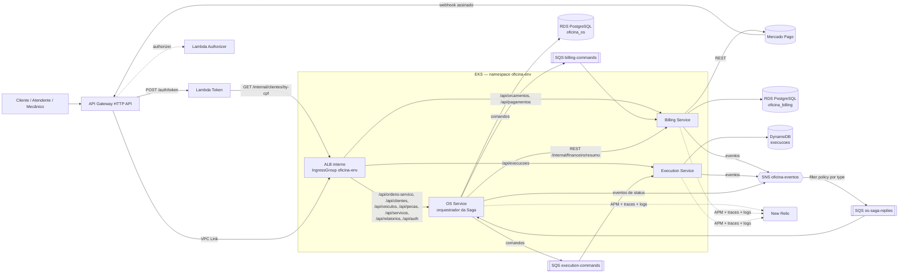
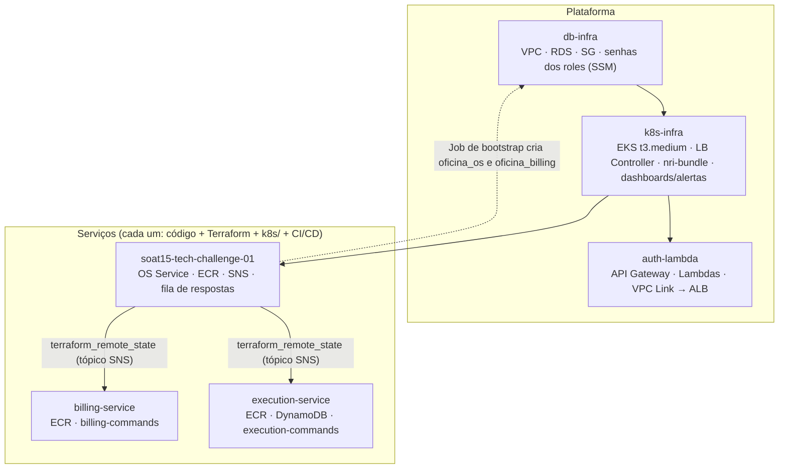

# Diagrama de Componentes — Fase 4 (microsserviços)

> Topologia vigente. A da Fase 3 (monólito atrás de um NLB) ficou em
> [`component-diagram-fase3.md`](component-diagram-fase3.md). Decisões: [`RFC-005`](rfcs/RFC-005-microsservicos-e-saga.md),
> `ADR-008` a `ADR-015`; contratos das mensagens: [`contratos-mensagens.md`](contratos-mensagens.md).

## Visão geral

- **Um banco por serviço** (ADR-008, ADR-012): `oficina_os` e `oficina_billing` na mesma instância RDS,
  cada um com seu role (`REVOKE CONNECT ... FROM PUBLIC`); `execucoes` no DynamoDB (NoSQL, ADR-011).
  **Nenhum serviço lê o banco de outro** — dados trafegam por mensagens e rotas `/internal/*`.
- **Comunicação síncrona (REST)**: borda → serviços pelo API Gateway; OS → Billing (`receitaTotal` do dashboard,
  com timeout de 2 s e fallback `null`); Lambda de token → OS (`/internal/clientes/by-cpf`, ADR-015); Billing → Mercado Pago.
- **Comunicação assíncrona**: comandos ponto a ponto em SQS, eventos em SNS (fan-out) — ADR-010. Todo envio passa por
  *transactional outbox* e todo consumo por *inbox* idempotente; cada fila tem DLQ (`maxReceiveCount = 5`).
- **Saga orquestrada** no OS Service (ADR-009): [sequência feliz](sequence-saga-feliz.md) e
  [compensações](sequence-saga-compensacao.md).

## Mensageria (por ambiente, prefixo `soat15-tc-<env>-`)

| Recurso | Tipo | Produtor → Consumidor | Dono (Terraform) |
|---|---|---|---|
| `billing-commands` (+ DLQ) | SQS | OS → Billing | Billing |
| `execution-commands` (+ DLQ) | SQS | OS → Execution | Execution |
| `oficina-eventos` | SNS | Billing, Execution e OS publicam | OS |
| `os-saga-replies` (+ DLQ) | SQS inscrita no SNS (raw delivery + filter policy) | → OS | OS |

## Infraestrutura (6 repositórios)

Ordem do primeiro deploy: `db-infra` → `k8s-infra` → **OS Service** → Execution/Billing → `auth-lambda`
(precisa do ALB). Destruição na ordem inversa (cabeçalho dos `destroy.yml`).
