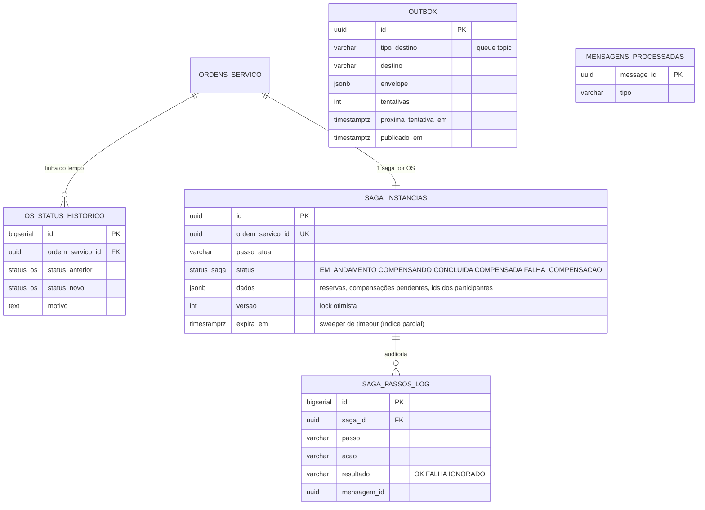
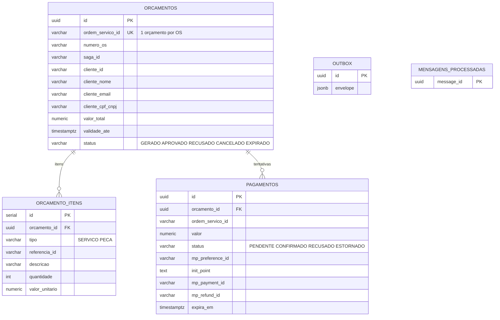

# Modelo de Dados — PostgreSQL (Fase 3)

Normalização do modelo documental do MongoDB (Fase 1/2) para o relacional exigido pela
Fase 3. Justificativa da escolha de banco relacional e do PostgreSQL especificamente em
[`rfcs/RFC-002-banco-de-dados.md`](rfcs/RFC-002-banco-de-dados.md). Decisão de manter
`servicos_os`/`servico_pecas` como tabelas normalizadas (em vez de colunas `jsonb`) em
[`adrs/ADR-004-modelo-relacional-normalizado.md`](adrs/ADR-004-modelo-relacional-normalizado.md).

## Diagrama ER

```mermaid
erDiagram
    CLIENTES ||--o{ VEICULOS : possui
    CLIENTES ||--o{ ORDENS_SERVICO : solicita
    VEICULOS ||--o{ ORDENS_SERVICO : "é objeto de"
    ORDENS_SERVICO ||--|{ SERVICOS_OS : contém
    SERVICOS_OS ||--o{ SERVICO_PECAS : consome
    PECAS ||--o{ SERVICO_PECAS : "é referenciada em"
    PECAS ||--|| ITENS_ESTOQUE : "tem estoque"
    ORDENS_SERVICO ||--o{ PAGAMENTOS : gera
    CATALOGO_SERVICOS ||..o{ SERVICOS_OS : "origina (referência histórica)"

    CLIENTES {
        uuid id PK
        varchar cpf_cnpj UK
        enum tipo "PF | PJ"
        varchar nome
        varchar email
        varchar telefone
        varchar logradouro
        varchar numero
        varchar cidade
        varchar uf
        varchar cep
        boolean ativo
        timestamptz criado_em
        timestamptz atualizado_em
    }

    VEICULOS {
        uuid id PK
        uuid cliente_id FK
        varchar placa UK
        varchar marca
        varchar modelo
        int ano
        int quilometragem
        timestamptz criado_em
        timestamptz atualizado_em
    }

    PECAS {
        uuid id PK
        varchar codigo UK
        varchar descricao
        enum categoria_peca
        enum unidade_medida
        numeric preco_venda
        timestamptz criado_em
        timestamptz atualizado_em
    }

    ITENS_ESTOQUE {
        uuid id PK
        uuid peca_id FK-UK "1:1 com pecas"
        int quantidade_disponivel "CHECK >= 0"
        int quantidade_reservada "CHECK >= 0"
        int quantidade_minima
        timestamptz atualizado_em
    }

    CATALOGO_SERVICOS {
        uuid id PK
        varchar descricao
        numeric preco
        numeric tempo_estimado
        timestamptz criado_em
        timestamptz atualizado_em
    }

    ORDENS_SERVICO {
        uuid id PK
        varchar numero_os UK
        uuid cliente_id FK
        uuid veiculo_id FK
        varchar cpf_cnpj "snapshot histórico"
        varchar placa "snapshot histórico"
        int quilometragem_entrada
        text observacoes
        enum status
        timestamptz data_abertura
        timestamptz atualizado_em
    }

    SERVICOS_OS {
        uuid id PK
        uuid ordem_servico_id FK "ON DELETE CASCADE"
        int ordem "preserva sequência do array original"
        varchar descricao
        int tempo_estimado_minutos
        numeric valor_mao_de_obra
        enum status_servico
    }

    SERVICO_PECAS {
        uuid id PK
        uuid servico_os_id FK "ON DELETE CASCADE"
        uuid peca_id FK
        int quantidade
        numeric preco_unitario "preço histórico, não segue o preço atual da peça"
    }

    PAGAMENTOS {
        uuid id PK
        uuid ordem_servico_id FK
        enum forma_pagamento
        enum status_pagamento
        numeric valor
        timestamptz criado_em
    }

    USUARIOS {
        uuid id PK
        varchar email UK
        varchar senha_hash
        varchar nome
        boolean ativo
        timestamptz criado_em
    }
```

> `USUARIOS` não tem FK para as demais tabelas — são as contas internas da oficina
> (login e-mail/senha), distintas dos `CLIENTES` (que autenticam por CPF via Lambda,
> sem senha própria no sistema).

## Relacionamentos e justificativa

| Relacionamento | Cardinalidade | Por quê |
|---|---|---|
| `clientes` → `veiculos` | 1:N | Um cliente pode ter vários veículos; `veiculos.cliente_id` é obrigatório (não existe veículo sem dono) |
| `clientes` → `ordens_servico` | 1:N | Histórico de OS por cliente; mantido mesmo que o veículo seja revendido |
| `veiculos` → `ordens_servico` | 1:N | Histórico de OS por veículo, independente de troca de dono |
| `ordens_servico` → `servicos_os` | 1:N (mínimo 1) | Substitui o array `servicos` embutido no documento Mongo; `ON DELETE CASCADE` porque um serviço não existe fora do contexto de uma OS |
| `servicos_os` → `servico_pecas` | 1:N (pode ser 0) | Substitui o array `pecasUtilizadas` embutido em cada serviço; `ON DELETE CASCADE` pelo mesmo motivo |
| `pecas` → `servico_pecas` | 1:N | Uma peça é usada em vários serviços ao longo do tempo; a FK aponta para o catálogo atual de peças, mas `preco_unitario` em `servico_pecas` é congelado no momento do uso |
| `pecas` → `itens_estoque` | 1:1 | Separado da tabela `pecas` porque estoque muda com frequência muito maior que o cadastro da peça (evita lock/contenção na tabela de catálogo); o Mongo já separava em coleções distintas (`pecas` e `itens-estoque`) |
| `catalogo_servicos` → `servicos_os` | referência histórica, sem FK rígida | `servicos_os` copia `descricao`/`valor_mao_de_obra`/`tempo_estimado_minutos` no momento da criação (mesmo padrão do código atual, que já resolve o catálogo e grava valores no `Servico.create()`) — alterar um item do catálogo não deve mudar OS já abertas |
| `ordens_servico` → `pagamentos` | 1:N | Uma OS pode ter mais de uma tentativa de pagamento registrada; índice único parcial garante no máximo um pagamento `CONFIRMADO` por OS (substitui a flag booleana `temPagamento` que hoje vive na própria OS) |

## Índices e invariantes que migram do código para o banco

| Invariante hoje garantida em código | Constraint/índice no PostgreSQL |
|---|---|
| `cpfCnpj` único por cliente (validado no use case antes de salvar) | `UNIQUE (cpf_cnpj)` em `clientes` |
| `placa` única por veículo | `UNIQUE (placa)` em `veiculos` |
| `numeroOS` único, gerado por contador atômico (`OSCounterModel` + `$inc`) | `UNIQUE (numero_os)` + `SEQUENCE numero_os_seq` nativa (sem coleção auxiliar) |
| `quantidadeDisponivel`/`quantidadeReservada` nunca negativas (checado em `ItemEstoque.reservar()`/`utilizar()`) | `CHECK (quantidade_disponivel >= 0 AND quantidade_reservada >= 0)` em `itens_estoque` — reforço no banco além da checagem de domínio, contra escrita direta que ignore a entidade |
| No máximo um pagamento confirmado por OS (checado implicitamente pela flag `temPagamento`) | Índice único parcial: `CREATE UNIQUE INDEX ON pagamentos (ordem_servico_id) WHERE status_pagamento = 'CONFIRMADO'` |
| Busca textual de peças por descrição (`$text` do Mongo) | Índice GIN `to_tsvector('portuguese', descricao)` em `pecas` |
| Listagem de OS ordenada por peso de status (`$addFields`/`$switch` no agregation pipeline) | `ORDER BY CASE status WHEN 'EM_EXECUCAO' THEN 1 ... END, data_abertura ASC` — não é constraint, mas documentado aqui por ser a mesma tradução 1:1 do pipeline Mongo |

## Chaves

Todas as chaves primárias permanecem `UUID` (tipo `uuid` nativo do Postgres, gerado pela
aplicação via `crypto.randomUUID()` como já acontece hoje — não `uuid-ossp`/`gen_random_uuid()`
no banco), para não invalidar IDs já emitidos e manter as factories `Entidade.create()` do
domínio inalteradas.

---

# Fase 4 — modelo de dados por serviço

Com a decomposição em microsserviços (ADR-008) cada serviço tem o **seu** banco e nenhum lê o de outro
(ADR-012). O modelo acima continua válido para `oficina_os`, com as mudanças abaixo.

## OS Service — `oficina_os` (PostgreSQL)

Mudanças em relação à Fase 3 (migrations `1735300010000` a `1735300014000`):

| Mudança | Por quê |
|---|---|
| `status_os` ganha `AGUARDANDO_PAGAMENTO` | o cliente precisa ver por que a OS parou entre a aprovação e a execução |
| `pagamentos` **removida** | pagamento virou responsabilidade do Billing; a OS só guarda a flag `temPagamento` |
| `os_status_historico` | linha do tempo de status (`GET /:id/historico`) |
| `saga_instancias`, `saga_passos_log` | estado e trilha de auditoria da Saga orquestrada |
| `outbox`, `mensagens_processadas` | *transactional outbox* e *inbox* idempotente (ADR-010) |



`outbox` e `mensagens_processadas` não têm FK: pertencem à infraestrutura de mensageria, não ao domínio.
O relay usa `FOR UPDATE SKIP LOCKED` (2+ réplicas nunca publicam a mesma linha).

## Billing Service — `oficina_billing` (PostgreSQL)

Dados transacionais e relacionais (orçamento ↔ itens ↔ pagamento); ids de outros serviços (OS, cliente, serviço/peça)
são `varchar` **sem FK** — a integridade entre serviços é garantida pelos contratos, não pelo banco.



Invariantes no banco: `UNIQUE (ordem_servico_id)` em `orcamentos`; **índice único parcial**
`pagamentos (orcamento_id) WHERE status IN ('PENDENTE','CONFIRMADO')` — no máximo um pagamento "vivo" por orçamento,
mesmo com `SolicitarPagamento` duplicado ou concorrente; `CHECK` de status.

## Execution Service — `execucoes` (DynamoDB, single-table)

Por que NoSQL aqui (ADR-011): o acesso é sempre por chave (id da execução, id da OS, "próximos da fila") e o
histórico é uma lista de eventos append-only — sem joins nem consultas ad hoc. Tabela on-demand com TTL.

| Item | PK | SK | GSI1 (fila) | GSI2 (por OS) | GSI3 (outbox pendente) |
|---|---|---|---|---|---|
| Execução | `EXEC#<id>` | `META` | `STATUS#<status>` / `<prio>#<criadoEm>#<id>` | `OS#<osId>` / `EXEC` | — |
| Histórico | `EXEC#<id>` | `EVT#<ts>#<rand>` | — | — | — |
| Trava da OS | `OSLOCK#<osId>` | `META` | — | — | — |
| Outbox | `OUTBOX#<messageId>` | `META` | — | — | `OUTBOX#PENDING` / `<ts>#<messageId>` (índice esparso) |
| Inbox | `INBOX#<messageId>` | `META` (TTL 7 d) | — | — | — |

- **Fila**: GSI1 ordena `ALTA` (0) antes de `NORMAL` (1) e depois por ordem de chegada.
- **Concorrência**: toda gravação é uma `TransactWriteItems` (estado + histórico + outbox + inbox) com
  `ConditionExpression` de versão (lock otimista); `OSLOCK#` garante uma execução por OS.
- **Outbox**: o relay reivindica cada item com um *lease* condicional (`lockedUntil`) — o equivalente ao
  `SKIP LOCKED` do Postgres; ao publicar, o item sai do GSI3 e ganha TTL.
- Código do modelo de chaves: `src/infrastructure/database/dynamodb/keys.ts` no repo do Execution Service.
