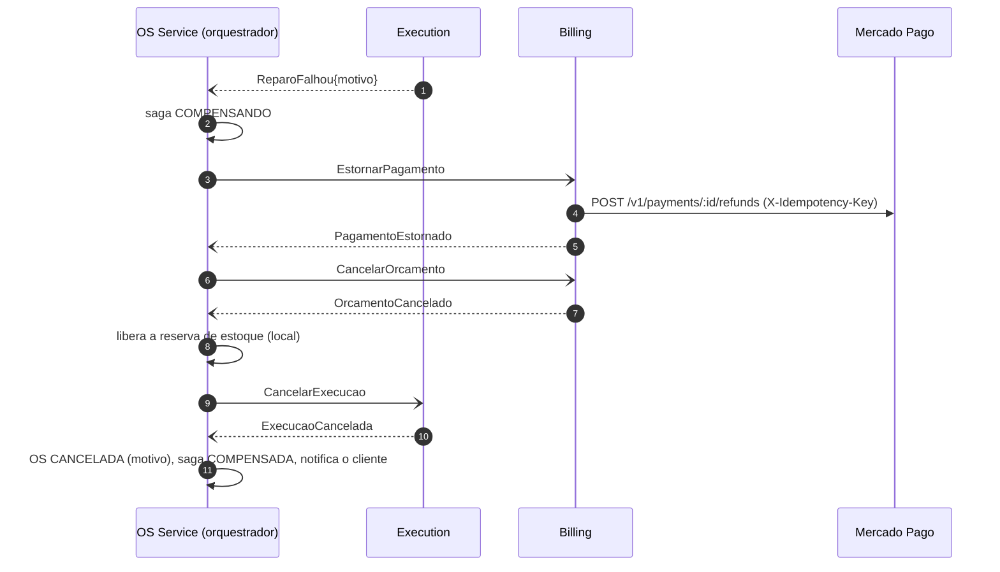

# Sequência — Saga do ciclo da OS, compensações

Se um passo falha (ou expira), o orquestrador compensa **em ordem inversa** a partir do último passo concluído.
Cada compensação é um comando idempotente com resposta obrigatória; falha de compensação é retentada
(`SAGA_MAX_TENTATIVAS_COMPENSACAO`) e, esgotadas as tentativas, a saga vai para `FALHA_COMPENSACAO` (alerta; intervenção
manual — a OS **não** é cancelada porque dinheiro/estado exigem decisão humana).

## Reparo falha (a compensação mais completa)

## O que é compensado em cada falha

| Gatilho | Compensações, em ordem | Verificado em |
|---|---|---|
| `DiagnosticoFalhou` | nada a desfazer (a execução já falhou no Execution) → OS `CANCELADA` | testes do orquestrador e contratos |
| `OrcamentoFalhou` | liberar reserva → `CancelarExecucao` → OS `CANCELADA` | orquestrador |
| `OrcamentoRecusado` | liberar reserva → `CancelarExecucao` → OS `CANCELADA` (o orçamento já está `RECUSADO` no Billing: não há `CancelarOrcamento`) | BDD cenário 2 |
| timeout de aprovação | `CancelarOrcamento` → liberar reserva → `CancelarExecucao` → OS `CANCELADA` | BDD cenário 5 |
| `PagamentoRecusado` / timeout de pagamento | `CancelarOrcamento` → liberar reserva → `CancelarExecucao` → OS `CANCELADA` (nada a estornar) | BDD cenário 3 |
| `ReparoFalhou` | `EstornarPagamento` → `CancelarOrcamento` → liberar reserva → `CancelarExecucao` → OS `CANCELADA` | BDD cenário 4 |
| `PATCH /:id/cancelar` (manual, `202`) | a partir do passo atual, como acima | orquestrador |
| `EstornoFalhou` (e demais falhas de compensação) | retry; esgotado ⇒ `FALHA_COMPENSACAO` | orquestrador |

## Casos de borda tratados

- **Pagamento tardio**: o cliente paga depois de a saga já ter compensado (timeout × checkout aberto). O Billing registra
  o pagamento (`RECUSADO → CONFIRMADO`), publica `PagamentoConfirmado` e o OS reabre a saga em `COMPENSANDO` só com
  `EstornarPagamento`.
- **Webhook perdido**: `POST /internal/pagamentos/:id/sincronizar` consulta o MP e aplica o resultado; o timeout de
  pagamento é a rede de segurança.
- **Webhook repetido/forjado**: assinatura inválida ⇒ 401; repetido ⇒ um só evento; valor diferente do cobrado ⇒ não confirma.
- **Mensagem perdida entre gravar e publicar**: impossível por construção (outbox na mesma transação); o relay reenvia
  com o mesmo `messageId` e o inbox do consumidor deduplica.
