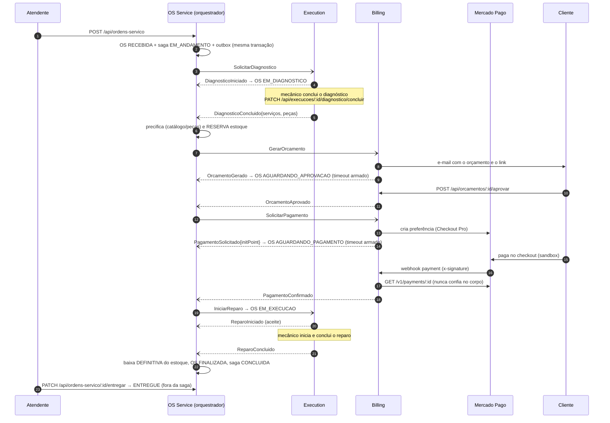

# Sequência — Saga do ciclo da OS, caminho feliz

Orquestrador no OS Service (`src/application/saga/`); estado em `saga_instancias`/`saga_passos_log`.
Setas tracejadas (`-)`/`--)`) são mensagens assíncronas (SQS/SNS) com outbox + inbox; as sólidas, chamadas síncronas
ou trabalho local. Contratos: [`contratos-mensagens.md`](contratos-mensagens.md).

## Passos da Saga

| # | Passo | Executor | Sucesso | Falha | Status da OS |
|---|---|---|---|---|---|
| 1 | Abrir OS | OS (local) | — | validação | `RECEBIDA` |
| 2 | Diagnóstico | Execution | `DiagnosticoConcluido` | `DiagnosticoFalhou` | `EM_DIAGNOSTICO` |
| 3 | Reservar peças | OS (local) | reserva atômica | estoque insuficiente | — |
| 4 | Gerar orçamento | Billing | `OrcamentoGerado` | `OrcamentoFalhou` | `AGUARDANDO_APROVACAO` |
| 5 | Aprovação | Billing (cliente) | `OrcamentoAprovado` | `OrcamentoRecusado` / timeout | — |
| 6 | Pagamento | Billing + MP | `PagamentoConfirmado` | `PagamentoRecusado` / timeout | `AGUARDANDO_PAGAMENTO` |
| 7 | Reparo | Execution | `ReparoConcluido` | `ReparoFalhou` | `EM_EXECUCAO` → `FINALIZADA` |
| 8 | Finalizar | OS (local) | baixa do estoque | — | `FINALIZADA` (ponto sem volta) |

Reentregas e mensagens fora de ordem não avançam a saga: o inbox descarta o `messageId` repetido e o orquestrador
registra respostas de passos já superados como `IGNORADO` (BDD: "mensagem duplicada não avança a saga duas vezes").
